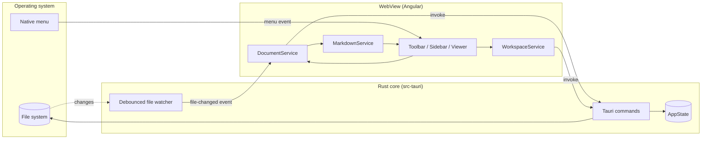

# Nixe — Architecture Documentation

Nixe is a [Tauri 2](https://tauri.app) desktop app: an Angular single-page app running
inside a native WebView, backed by a small Rust core for anything that needs real OS
access (file I/O, the file watcher, the native menu, single-instance handling).

This folder is real documentation, and also doubles as a fixture: open it with
**File → Open Folder…** to exercise the sidebar tree, nested folders, cross-file
links and Mermaid rendering all at once.

## Map

- [architecture.md](architecture.md) — process boundary, IPC, startup sequence
- [backend/README.md](backend/README.md) — the Rust core (`src-tauri/`)
  - [backend/tauri-commands.md](backend/tauri-commands.md) — the command surface
  - [backend/file-watching.md](backend/file-watching.md) — live reload
- [frontend/README.md](frontend/README.md) — the Angular app (`src/`)
  - [frontend/markdown-pipeline.md](frontend/markdown-pipeline.md) — Markdown → HTML
  - [frontend/state-management.md](frontend/state-management.md) — signals & navigation

## System at a glance

See [architecture.md](architecture.md) for the details behind each box.
