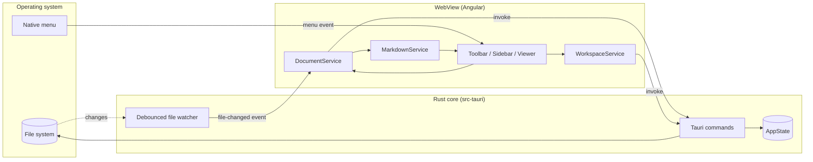

# Nixe — Architecture Documentation

Nixe is a [Tauri 2](https://tauri.app) desktop app: an Angular single-page app running
inside a native WebView, backed by a Rust core for anything that needs real OS
access (file I/O, the file watcher, the native menu, single-instance handling) and, as the
vault app grows, the vault index and Git sync.

This folder is real documentation, and also doubles as a fixture: open it with
**File → Open Folder…** to exercise the sidebar tree, nested folders, cross-file
links and Mermaid rendering all at once.

## Map

- [architecture.md](architecture.md) — process boundary, IPC, startup sequence
- [workspaces.md](workspaces.md) — several folders in one window
- [capture.md](capture.md) — the global shortcut and the capture window
- [cli.md](cli.md) — querying the vault from the terminal
- [export.md](export.md) — a note as standalone HTML, PDF or print
- [mcp.md](mcp.md) — the read-only MCP server for agents
- [updater.md](updater.md) — auto update, signing and key handling
- [cutover.md](cutover.md) — the checklist for replacing Obsidian
- [roadmap.md](roadmap.md) — milestones M000 to M009 of the vault app
- [adr/](adr/) — architecture decisions
- [backend/README.md](backend/README.md) — the Rust core (`src-tauri/`)
  - [backend/tauri-commands.md](backend/tauri-commands.md) — the command surface
  - [backend/file-watching.md](backend/file-watching.md) — live reload
- [frontend/README.md](frontend/README.md) — the Angular app (`src/`)
  - [frontend/markdown-pipeline.md](frontend/markdown-pipeline.md) — Markdown → HTML
  - [frontend/editor.md](frontend/editor.md) — CodeMirror editor and saving
  - [frontend/bookmarks.md](frontend/bookmarks.md) — bookmarks of notes, headings and searches
  - [frontend/state-management.md](frontend/state-management.md) — signals & navigation
  - [frontend/terminal.md](frontend/terminal.md) — the terminal panel with xterm.js
  - [frontend/demo.md](frontend/demo.md) — the demo build, e2e tests and screenshots
- [theming.md](theming.md) — themes, CSS snippets and the CSS variables

## System at a glance

See [architecture.md](architecture.md) for the details behind each box.

## Demo build

The full description, with how to add the answer for a new command and a test, is in [frontend/demo.md](frontend/demo.md).

`pnpm start:demo` serves the app in a plain browser on port 1422 (`ng serve --configuration demo`). `tsconfig.demo.json` replaces every `@tauri-apps/*` module with a stand-in in `src/demo/tauri/`; the commands are answered by `DemoBackend` (`src/demo/kit/`) from an in-memory vault with fixed notes and a fixed clock (`src/demo/nixe/`), a seeded Git history with open changes and a branch to review (`git.ts`), in-memory workspaces and a terminal that echoes. `src/demo/nixe/demo.spec.ts` fails when a command of `core/file/backend.ts` or `core/terminal/terminal-backend.ts` is neither answered nor listed with a reason in `excluded.ts`; the specs in `src/demo/e2e/` call the typed wrappers of the app against the demo backend per area (Git view, History, Settings). A command nobody answered is listed in `window.__demoFailures`; every call is recorded in `window.__demoCalls`. With `?backend=fake` the page uses the scripted variant instead (`src/demo/kit/fake.ts`, `createFakeBackend(answers)`): it answers only what an init script sets in `window.__demoScript` or a test sets at runtime with `window.__demo.answer(command, value)`, fails every other command by name, pushes events with `window.__demo.emit(event, payload)` and lists the calls with `window.__demo.calls(command?)`. The production build excludes `src/demo`.

`pnpm e2e` runs the Playwright tests in `e2e/` (`playwright.config.ts`) against the demo dev server (`webServer` starts `pnpm start:demo`, or reuses a running one locally), in Chromium, in a light and a dark project, with reduced motion. `e2e/smoke.e2e.ts` runs on the demo variant, `e2e/interaction.e2e.ts` on the fake variant (`?backend=fake`, answers in `e2e/fake-vault.ts`) and asserts an action by its recorded call. `e2e/fixtures.ts` fails every test on a `pageerror`, a `console.error` or an entry of `window.__demoFailures`; `e2e/steps.ts` holds the steps (`ready`, `openNote`, `openPalette`, `takeCalls`, …) that `pnpm screenshots` shares. Tests wait on conditions: the oxlint rule `nixe-e2e/no-wait-for-timeout` (`e2e/lint/plugin.mjs`, probe in `src/testing/lint-probe.spec.ts`) rejects `waitForTimeout`. CI runs the `e2e` job on pull requests as advisory (it is not part of `ci`'s `needs`); a failed run uploads the report and the traces. The first run needs `pnpm exec playwright install chromium`.

### Screenshots

`pnpm screenshots [name...] [--out <dir>]` writes `<name>-light.png` and `<name>-dark.png` for the docs and the site (default folder `site/public/screenshots`). `scripts/browser/playwright.mjs` installs Chromium when it is missing, starts the demo server on port 1422 (or reuses the one that runs) and opens a page per theme with a fixed clock, no animation and a 1280×800 window, so two runs give the same images. `scripts/screenshots/views.mjs` lists the views (`editor`, `backlinks`, `search`) and the step helpers (`ready`, `openNote`, `searchFor`, …) that the e2e tests reuse. An unknown view name is an error (exit 2). A command the demo backend does not answer fails the run with its name; a view that fails leaves `tmp/shots/failed-<name>-<theme>.png` (git-ignored).
