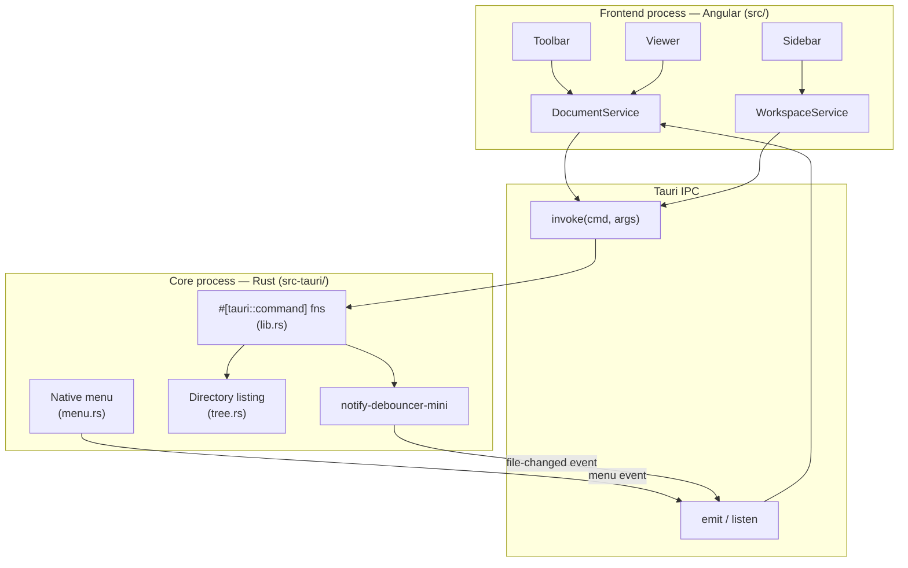
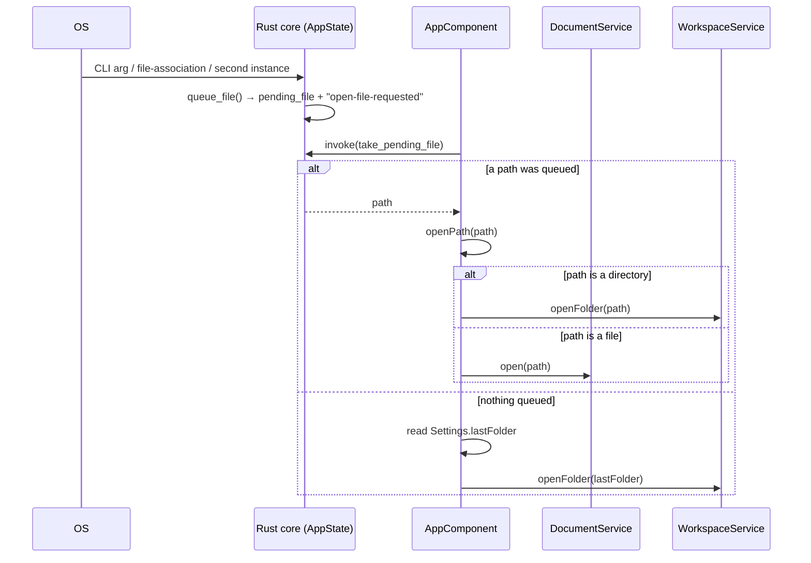

# Architecture

Nixe follows the standard Tauri split: a **frontend process** (Angular, running in the
OS-native WebView — WKWebView on macOS, WebView2 on Windows, WebKitGTK on Linux) and a
**core process** (the compiled Rust binary, `src-tauri/`) that owns the OS integration.
The two only talk through Tauri's IPC bridge: `invoke()` calls from the frontend to
`#[tauri::command]` functions, and events emitted in either direction.

## Why a Rust core at all

Everything that isn't pure presentation lives on the Rust side, mainly because the
WebView has no direct filesystem access:

- reading/watching files (`read_text_file`, `watch_file`)
- listing directories for the sidebar, `.order`-aware (`list_dir`, see `tree.rs`)
- finding the Azure DevOps wiki root for `/absolute` link resolution (`find_wiki_root`)
- the native menu (`menu.rs`) and OS file-association / CLI / single-instance handling

The frontend is intentionally "dumb" about the OS: `src/app/core/file/backend.ts` is a
thin typed wrapper around `invoke()`, and everything above it works with plain strings
and signals.

## Startup sequence

A file can reach the app three ways: a CLI argument, double-clicking a file associated
with Nixe, or dropping a file/folder onto a already-running instance (forwarded through
`tauri-plugin-single-instance`). All three converge on the same `AppState.pending_file`
slot, which the frontend drains once on startup.

## Cross-cutting concerns

- **Paths** are always normalized to forward slashes at the Rust/JS boundary
  (`path_to_string` in Rust, `toSlashes` in `core/markdown/paths.ts`) so the frontend
  never has to branch on platform.
- **Security**: rendered Markdown is sanitized with DOMPurify before it touches the
  DOM (see [frontend/markdown-pipeline.md](frontend/markdown-pipeline.md)), and the
  CSP in `tauri.conf.json` restricts script/style/connect sources.
- **This very folder** is a plain (non-ADO) nested folder — no `.order` files — so
  opening it exercises the "regular folder" code path in `tree.rs` / `tree-model.ts`,
  complementing `fixtures/wiki`, which exercises the ADO-wiki path.
