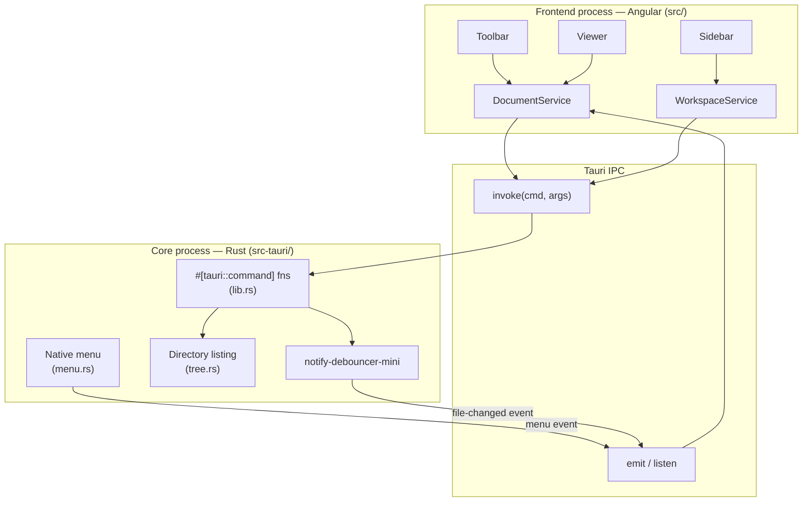
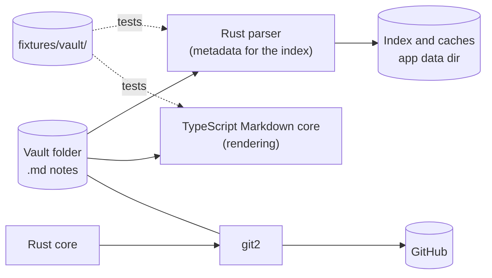
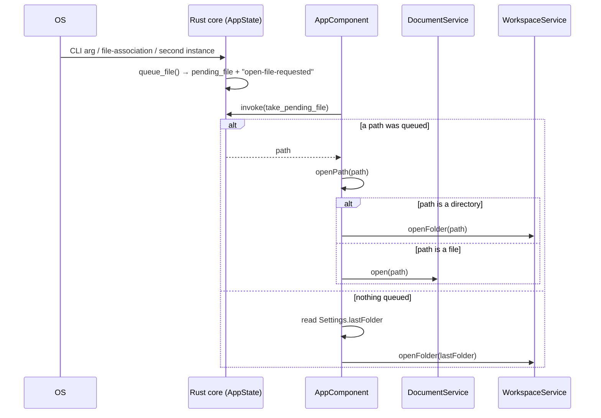

# Architecture

Nixe follows the standard Tauri split: a **frontend process** (Angular, running in the
OS-native WebView — WKWebView on macOS, WebView2 on Windows, WebKitGTK on Linux) and a
**core process** (the compiled Rust binary, `src-tauri/`) that owns the OS integration.
The two only talk through Tauri's IPC bridge: `invoke()` calls from the frontend to
`#[tauri::command]` functions, and events emitted in either direction.

## Why a Rust core at all

Everything that isn't pure presentation lives on the Rust side, mainly because the
WebView has no direct filesystem access:

- reading/watching files (`read_text_file`, `watch_file`)
- listing directories for the sidebar, `.order`-aware (`list_dir`, see `tree.rs`)
- finding the Azure DevOps wiki root for `/absolute` link resolution (`find_wiki_root`)
- the native menu (`menu.rs`) and OS file-association / CLI / single-instance handling

The frontend is intentionally "dumb" about the OS: `src/app/core/file/backend.ts` is a
thin typed wrapper around `invoke()`, and everything above it works with plain strings
and signals.

## Vault app: Rust core and two parsers

[ADR 0003](adr/0003-nixe-becomes-a-vault-app-with-editing-and-git-sync.md) makes the Rust core
the home of everything about the vault; the frontends stay thin. Planned and partly built (see
[roadmap](roadmap.md)):

- **Vault:** scan of the opened folder (`.obsidian/` marks the root), reading and writing notes.
  Writes go to the notes the user edits, through a temporary file and a rename. File names are
  relative to the vault and may not leave it.
- **Index:** wikilinks, backlinks, tags, headings, frontmatter properties (with their types) and
  full-text search.
- **Git:** `git2` (libgit2) over HTTPS with a token: clone, pull with rebase, auto-commit, push.
  On a conflict the remote version stays in the note and the local version is written next to
  it as a conflict copy ([ADR 0004](adr/0004-tauri-on-ios-go-git2-for-git-sync-native-swift-only-for-file-access-outside-the-sandbox.md)).
  The token is kept in the OS keychain.

### Two parsers, one fixture vault

The TypeScript Markdown core (markdown-it plugins) renders notes and keeps its own grammar. The
Rust core extracts links, embeds, tags, headings and frontmatter for the index, so a SwiftUI
frontend could use the core without the WebView. Both parsers will be tested against the same
fixture vault under `fixtures/vault/`, so they cannot drift apart unnoticed. Each note there has an
expected-metadata file in `fixtures/vault/.meta/<path>.json`; `vault::meta` (Rust) and
`meta-fixture.spec.ts` (Vitest) both check their parser against it. Regenerate the files after an
intended grammar change with `NIXE_UPDATE_FIXTURES=1 cargo test vault::meta` and review the diff.

### What Nixe writes, and where

| What | Where |
|---|---|
| Notes the user edits | the vault |
| Git metadata and conflict copies | the vault (`.git/`, next to the note) |
| Index, search data and other caches | app data directory, rebuilt on open, never in the vault |
| Git token | OS keychain, never on disk |
| `.obsidian/` | never written |

## Startup sequence

A file can reach the app three ways: a CLI argument, double-clicking a file associated
with Nixe, or dropping a file/folder onto a already-running instance (forwarded through
`tauri-plugin-single-instance`). All three converge on the same `AppState.pending_file`
slot, which the frontend drains once on startup.

## Cross-cutting concerns

- **Paths** are always normalized to forward slashes at the Rust/JS boundary
  (`path_to_string` in Rust, `toSlashes` in `core/markdown/paths.ts`) so the frontend
  never has to branch on platform.
- **Security**: rendered Markdown is sanitized with DOMPurify before it touches the
  DOM (see [frontend/markdown-pipeline.md](frontend/markdown-pipeline.md)), and the
  CSP in `tauri.conf.json` restricts script/style/connect sources.
- **This very folder** is a plain (non-ADO) nested folder — no `.order` files — so
  opening it exercises the "regular folder" code path in `tree.rs` / `tree-model.ts`,
  complementing `fixtures/wiki`, which exercises the ADO-wiki path.
