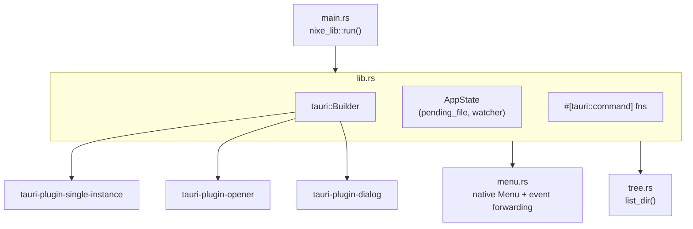

# Backend (`src-tauri/`)

The Rust core is a single crate, `nixe_lib`, exposing `run()` from `lib.rs`. It has
almost no business logic — its job is to give the frontend safe, narrow access to the
filesystem and the OS.



## `AppState`

```rust
struct AppState {
    pending_file: Mutex<Option<String>>,
    watcher: Mutex<Option<Debouncer<RecommendedWatcher>>>,
}
```

Two pieces of mutable state, both behind a `Mutex` because Tauri commands may run on
any thread:

- `pending_file` — a path waiting to be picked up by `take_pending_file`, set by
  `queue_file()` from the CLI-args parser, the file-association handler, or a second
  app instance.
- `watcher` — the currently active file watcher. Opening a new file *replaces* it, so
  only ever one file is watched at a time (see
  [file-watching.md](file-watching.md)).

## Modules

| Module      | Responsibility                                                              |
| ----------- | ---------------------------------------------------------------------------- |
| `main.rs`   | Binary entry point, just calls `nixe_lib::run()`.                            |
| `lib.rs`    | App setup, `AppState`, all `#[tauri::command]` functions, CLI/file-assoc glue. |
| `menu.rs`   | Builds the native `Menu` (File/Edit/View, +App/Window on macOS) and forwards custom item clicks as a `"menu"` event. |
| `tree.rs`   | `list_dir()`: turns a directory into the sidebar's `DirEntry[]`, `.order`-aware. |

Continue with [tauri-commands.md](tauri-commands.md) for the full IPC surface, or
[file-watching.md](file-watching.md) for how disk changes reach the UI.
