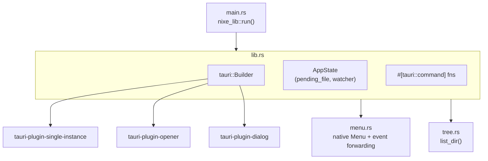

# Backend (`src-tauri/`)

The Rust core is a single crate, `nixe_lib`, exposing `run()` from `lib.rs`. It has
almost no business logic — its job is to give the frontend safe, narrow access to the
filesystem and the OS.



## `AppState`

```rust
struct AppState {
    pending_file: Mutex<Option<String>>,
    watcher: Mutex<Option<Debouncer<RecommendedWatcher>>>,
}
```

Two pieces of mutable state, both behind a `Mutex` because Tauri commands may run on
any thread:

- `pending_file` — a path waiting to be picked up by `take_pending_file`, set by
  `queue_file()` from the CLI-args parser, the file-association handler, or a second
  app instance.
- `watcher` — the currently active file watcher. Opening a new file *replaces* it, so
  only ever one file is watched at a time (see
  [file-watching.md](file-watching.md)).

## Modules

| Module      | Responsibility                                                              |
| ----------- | ---------------------------------------------------------------------------- |
| `main.rs`   | Binary entry point, just calls `nixe_lib::run()`.                            |
| `lib.rs`    | App setup, `AppState`, all `#[tauri::command]` functions, CLI/file-assoc glue. |
| `menu.rs`   | Builds the native `Menu` (File/Edit/View, +App/Window on macOS) and forwards custom item clicks as a `"menu"` event. |
| `tree.rs`   | `list_dir()`: turns a directory into the sidebar's `DirEntry[]`, `.order`-aware. |
| `bases/`    | Parses `.base` files and answers a table view from the vault index ([bases](../bases.md)). |

Continue with [tauri-commands.md](tauri-commands.md) for the full IPC surface, or
[file-watching.md](file-watching.md) for how disk changes reach the UI.

## `vault::meta` and `vault::resolve`

`vault/meta.rs` turns the text of one note into `NoteMeta` (`extract`): wikilinks and embeds
(target, heading, block, alias), Markdown links to notes, inline and frontmatter tags, headings,
block ids, typed frontmatter properties (text, number, checkbox, date, list) and aliases. Code
spans, fences and `%%comments%%` are skipped. Invalid frontmatter gives a note without
properties and the warning `invalid-frontmatter`, never an error. `vault/resolve.rs` resolves a
link target to a file (exact path, then unique basename, case-insensitive) like
`wikilink-resolver.ts`. Links inside frontmatter values are not extracted.

## Vault index (`index/`)

A SQLite file per vault at `<app-data>/index/<vault-hash>.sqlite` (`rusqlite`, bundled). It holds
`files` (scan state), `notes`, `links` (target, resolved path, kind `link`/`embed`/`markdown`),
`tags`, `headings`, typed `properties` and the FTS5 table `notes_fts` (rowid = note id). The
schema version is `PRAGMA user_version`; a different version, or a file that is not a database,
is deleted and rebuilt. The index is derived data and is never written into the vault.

`scan` walks the vault (`vault::walk_vault`, which skips `.obsidian/`, `.git/`, `.trash/` and
`.gitignore`d paths) and re-extracts only notes whose mtime or size changed, in one transaction.
When files appear or vanish, all links are resolved again.

The frontend calls `index_start(root)` after the first note is shown; the scan runs on a
background thread and emits `index-status` events (`{state, done, total, notes, error}`).
Read commands: `notes`, `note_meta(path)`, `backlinks(path)`, `tags`, `index_status`.
