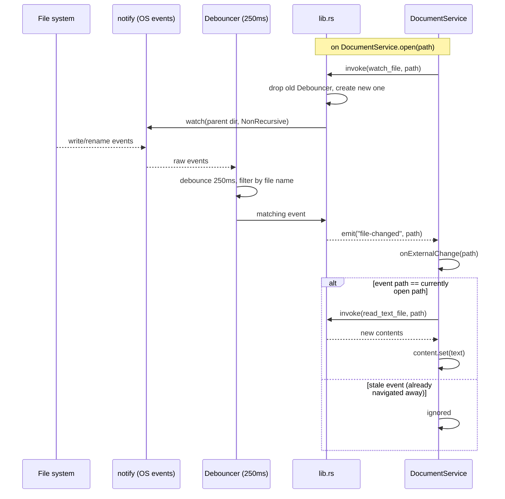

# Live reload

Nixe watches the *currently displayed file* so external edits (another editor, a git
checkout, a build script) show up without the user reloading manually.

## Why watch the directory, not the file

Editors frequently save by writing a temp file and renaming it over the original —
which unlinks the original inode. Watching the file directly would silently stop
working after the first external save. Instead, `watch_file` watches the **parent
directory** non-recursively and filters events by file name:

```rust
let mut debouncer = new_debouncer(Duration::from_millis(250), move |res| {
    if let Ok(events) = res {
        if events.iter().any(|e| e.path.file_name() == file_name) {
            let _ = app.emit(FILE_CHANGED_EVENT, &path);
        }
    }
});
debouncer.watcher().watch(&dir, RecursiveMode::NonRecursive)?;
```

The 250 ms debounce absorbs editors that emit several filesystem events per save.

## One watcher at a time

`AppState.watcher` holds a single `Debouncer`. Calling `watch_file` again — which
happens every time `DocumentService.open()` runs — simply overwrites the `Mutex`'s
content; the old `Debouncer` is dropped, which stops its `notify` watcher. So only the
file currently on screen is ever watched, and switching documents can't leak watchers.



`DocumentService.onExternalChange` double-checks the path because the event and the
navigation that supersedes it can race; a stale event for a file that's no longer open
is simply dropped. When the editor holds unsaved edits, `DocumentService.editorHook` decides
(the tracker classifies the disk text as reload, ignore or conflict): a clean note reloads, a
dirty one asks before it is overwritten. A read that fails outright (file mid-replace) is swallowed too — the
next debounced event picks up the final content.

## Vault-wide watcher

Next to the single-file watcher, `index_start` starts a second debouncer (300 ms) that watches
the **vault root recursively** (`index/commands.rs`, `watch_vault`). It catches changes of
other editors and `git pull`. One batch goes through three steps:

1. `watch::map_events` turns the raw paths into `VaultChange { path, kind, from? }`. The disk
   decides the kind: a missing path is `remove`, an unknown one `create`, an indexed one
   `modify`. A removed and a created file of the same size, with no other candidate, form one
   `rename` (`from` is the old path). A removed folder removes every indexed file below it.
   `.git/`, `.obsidian/`, `.trash/` and paths outside the vault are dropped.
2. `watch::apply_changes` updates the index in one transaction: changed notes are
   re-extracted, removed ones deleted, a rename moves the row; links are re-resolved when the
   set of files changed. It waits for a running scan (`scan_lock`).
3. The app emits `vault-changed` with the `VaultChange[]`, so the frontend reads fresh data
   (backlinks, search, tree) after the event.

Folders count too: a new or removed folder without files below it is reported as `create` or
`remove` of the folder path (a removed folder with indexed files is reported through those files).
The temp file of the app's own atomic save (`.<name>.nixe-tmp`, `write.rs`) is dropped like
`.git/`, so a save of the app never loops back as a change.

### What the frontend does with `vault-changed`

| Consumer | Reaction |
|---|---|
| `IndexService.revision` | moves on every batch: backlinks, search, health and the Git changes view (`GitService.refresh`) read again; an unchanged Git status keeps its object |
| `WorkspaceService.onVaultChanged` | reloads the file tree (expanded folders stay open) when a change is a `create`, `remove` or `rename`; a `modify` never reloads it, so the autosave of the open note does not. Reloads that overlap run once more instead of in parallel |
| `BookmarksService` | follows a `rename` |

A burst (a `git checkout`, an agent run) is one debounced batch of 300 ms, so the tree reloads
once. At most one vault watcher exists: `index_start` replaces `IndexState.watcher` when another
vault opens, which drops (and stops) the old one; it ends with the app.

Live reload of the open note is unchanged: it still uses `file-changed` from `watch_file`.
