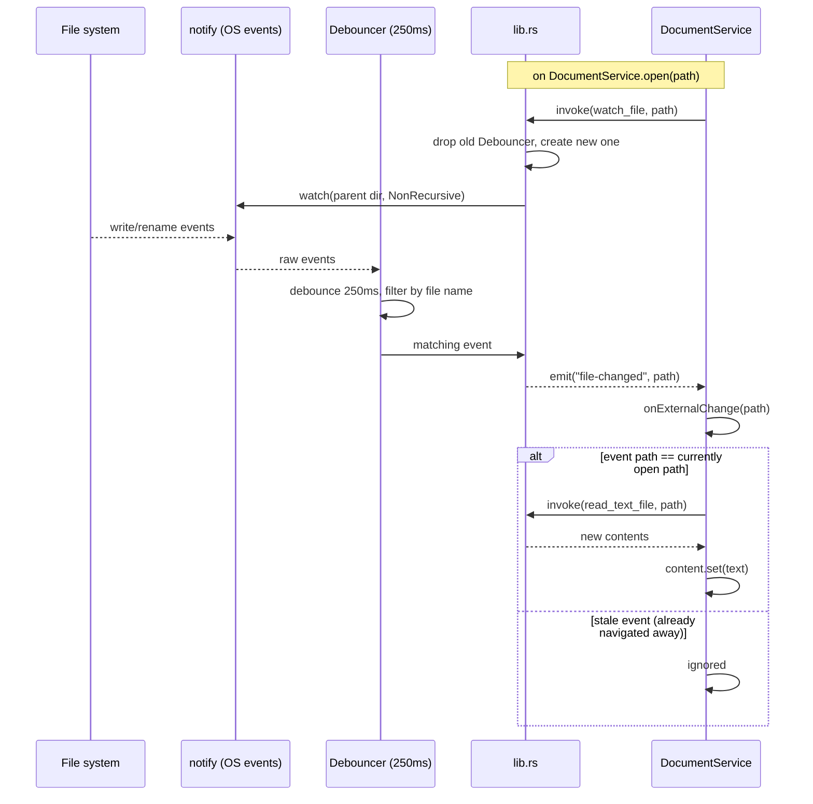

# Live reload

Nixe watches the *currently displayed file* so external edits (another editor, a git
checkout, a build script) show up without the user reloading manually.

## Why watch the directory, not the file

Editors frequently save by writing a temp file and renaming it over the original —
which unlinks the original inode. Watching the file directly would silently stop
working after the first external save. Instead, `watch_file` watches the **parent
directory** non-recursively and filters events by file name:

```rust
let mut debouncer = new_debouncer(Duration::from_millis(250), move |res| {
    if let Ok(events) = res {
        if events.iter().any(|e| e.path.file_name() == file_name) {
            let _ = app.emit(FILE_CHANGED_EVENT, &path);
        }
    }
});
debouncer.watcher().watch(&dir, RecursiveMode::NonRecursive)?;
```

The 250 ms debounce absorbs editors that emit several filesystem events per save.

## One watcher at a time

`AppState.watcher` holds a single `Debouncer`. Calling `watch_file` again — which
happens every time `DocumentService.open()` runs — simply overwrites the `Mutex`'s
content; the old `Debouncer` is dropped, which stops its `notify` watcher. So only the
file currently on screen is ever watched, and switching documents can't leak watchers.



`DocumentService.onExternalChange` double-checks the path because the event and the
navigation that supersedes it can race; a stale event for a file that's no longer open
is simply dropped. A read that fails outright (file mid-replace) is swallowed too — the
next debounced event picks up the final content.
