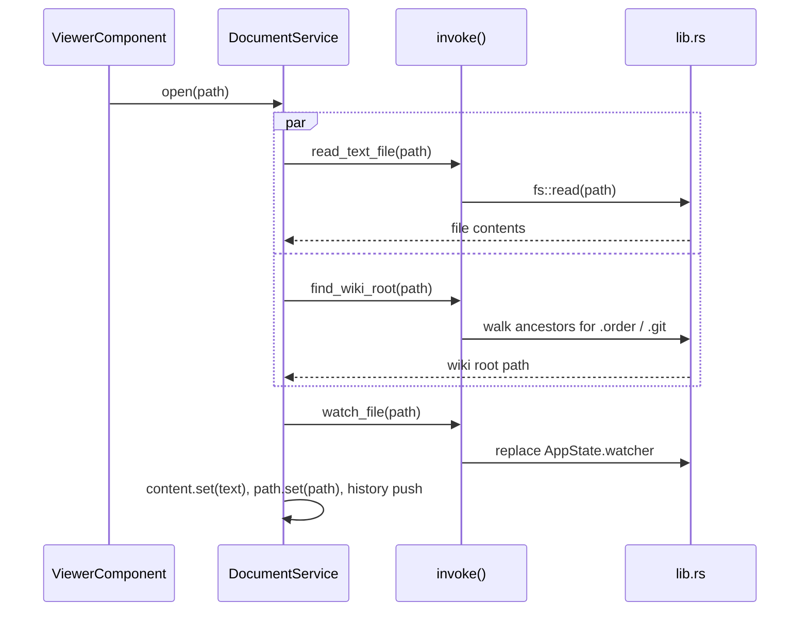

# Tauri commands

All commands are registered once in `lib.rs`'s `invoke_handler!` and given a typed
wrapper on the frontend in `src/app/core/file/backend.ts`, so nothing outside that file
calls `invoke()` directly.

| Command             | Rust signature                                   | Called from                    | Purpose |
| -------------------- | ------------------------------------------------- | ------------------------------- | ------- |
| `take_pending_file`  | `() -> Option<String>`                            | `AppComponent` (startup)        | Drains a path queued by CLI args / file association / second instance. |
| `read_text_file`     | `(path: String) -> Result<String, String>`        | `DocumentService.open/reload`   | Reads a file as UTF-8 (lossy). |
| `is_file`            | `(path: String) -> bool`                          | `ViewerComponent` (link resolve), `AppComponent` | Existence check for link targets. |
| `is_dir`             | `(path: String) -> bool`                          | `AppComponent.openPath`         | Decides file vs. folder when opening a dropped/CLI path. |
| `list_dir`           | `(path: String) -> Result<Vec<DirEntry>, String>` | `WorkspaceService.load`         | One folder level for the sidebar tree. |
| `find_wiki_root`     | `(path: String) -> String`                        | `DocumentService.open`          | Topmost `.order` ancestor, for `/absolute` links and images. |
| `watch_file`         | `(path: String) -> Result<(), String>`            | `DocumentService.open`          | (Re-)starts the live-reload watcher for the current file. |

## Example: opening a file

`read_text_file` and `find_wiki_root` are fired with `Promise.all` — they're
independent, so there is no reason to serialize them.

## Error handling

Commands that can fail (`read_text_file`, `list_dir`, `watch_file`) return
`Result<T, String>`; Tauri turns the `Err` branch into a rejected Promise on the JS
side. `AppComponent.run()` is the single place that catches these and turns them into
the toast notification shown at the bottom of the window — there's no per-call
try/catch scattered through the services.
