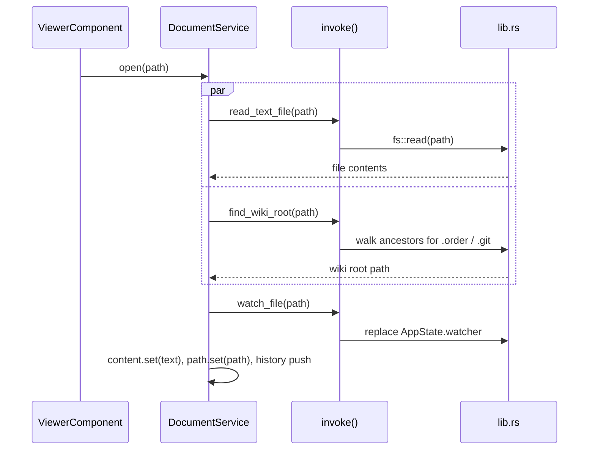

# Tauri commands

All commands are registered once in `lib.rs`'s `invoke_handler!` and given a typed
wrapper on the frontend in `src/app/core/file/backend.ts`, so nothing outside that file
calls `invoke()` directly.

| Command             | Rust signature                                   | Called from                    | Purpose |
| -------------------- | ------------------------------------------------- | ------------------------------- | ------- |
| `take_pending_file`  | `() -> Option<String>`                            | `AppComponent` (startup)        | Drains a path queued by CLI args / file association / second instance. |
| `read_text_file`     | `(path: String) -> Result<String, String>`        | `DocumentService.open/reload`   | Reads a file as UTF-8 (lossy). |
| `read_epub`          | `(path: String, roots: Vec<String>) -> Result<Response, String>` | `backend.readEpub` | The raw bytes of an `.epub` book (#486, `epub.rs`), so the WebView never reads the file. The canonical path (symlinks resolved) must lie below the vault root or one of `roots`, the roots of the open workspace; other extensions, folders and files over 50 MB are refused with an error that names the cause. `roots` comes from the frontend like in `workspace_index`: the check confines a book to folders the user opened, it is no defence against a compromised WebView. |
| `download_epub` | `(url: String) -> Result<String, String>` | `backend.downloadEpub` (via `TabsService.openEpub`) | Downloads an EPUB from an `https` URL (`ureq`, 60 s, 50 MB, redirects only to `https`) into `books/` of the app data directory and returns the file path; an existing file is reused without a request. Refuses other schemes, an oversized body and a body that is no EPUB (#491). `read_epub` also accepts this folder. |
| `read_epub_position` | `(key: String) -> Option<String>` | `backend.readEpubPosition` | The saved reading position (JSON text) of a book, from `.nixe/epub/` of the open vault (#489, `reading.rs`). `None` for a missing or damaged file or when no vault is open. |
| `write_epub_position` | `(key: String, content: String) -> Result<(), String>` | `backend.writeEpubPosition` | Atomically replaces the file of the book `key` in `.nixe/epub/`; refuses text that is no JSON object or over 64 KB. |
| `write_text_file`    | `(path: String, content: String) -> Result<(), String>` | `DocumentService.write` (editor) | Atomic write (temp file in the same folder, then rename). Only a note file below the vault root (set by `find_vault_root`) or in the folder of the open note (set by `watch_file`); refuses symlinks and notes over 5 MB. |
| `create_file`        | `(path: String) -> Result<(), String>`            | `VaultOpsService`               | Creates an empty file; never overwrites. Only below the vault root (symlinks resolved, `..` refused). |
| `create_dir`         | `(path: String) -> Result<(), String>`            | `VaultOpsService`               | Creates a folder and its missing parents below the vault root. |
| `rename_path`        | `(from: String, to: String) -> Result<Vec<Change>, String>` | `VaultOpsService.rename`       | Moves a file or folder inside the vault; refuses to replace, to move a folder into itself and any path outside the root. Rewrites the links to the moved files in the notes that refer to them (`vault/relink.rs`) and returns those notes. The paths of the folder and file roles of `.nixe/config.json` that are the moved path or below it follow in the same operation (`vault::config::rename_roles`), so the one commit and its undo hold both (#446). |
| `relink_preview`     | `(from: String, to: String) -> Result<Vec<Change>, String>` | `VaultOpsService.rename`       | The notes a rename would rewrite (`path`, `links`); changes nothing. Used for the confirmation of a folder rename. |
| `extract_preview` / `extract_text` | `(source, target, what, embed) -> Result<Vec<Change>, String>` | `ComposerService` | Moves a selection (UTF-16 offsets plus its text as a guard) or the section of a heading (1-based line) of `source` into the note `target`, created when missing, and leaves `[[target]]` or `![[target]]`. Links to a heading or block id that moved are retargeted. `extract_preview` only lists the notes (`path`, `action`, `links`). One burst of writes, the target first (`vault/composer.rs`). |
| `merge_preview` / `merge_note` | `(source, target) -> Result<Vec<Change>, String>` | `ComposerService` | Appends `source` (without its frontmatter) to `target`, rewrites the links to `source` (heading and block kept) and moves `source` to `.trash/`. |
| `last_vault_operation` / `undo_vault_operation` | `() -> Result<Option<Operation>, String>` / `(name?, email?) -> Result<Operation, String>` | `VaultUndoService` | In a Git vault `rename_path`, `merge_note`, `extract_text` and `trash_path` each commit the open edits first (`checkpoint before …`), then the operation as one commit (`rename: A -> B, links in 9 notes`, trailer `Nixe-Operation: <kind>`; `vault/ops.rs`). `last_vault_operation` finds the newest one not undone yet, `undo_vault_operation` reverts it as a new commit (`Nixe-Undo: <id>`), also when edits came after it; a revert that conflicts is refused and changes nothing. Without Git the operations run as before and there is nothing to undo. |
| `trash_path`         | `(path: String) -> Result<String, String>`        | `VaultOpsService.trash`         | Moves to `.trash/` at the vault root (Obsidian's default), numbering a taken name; returns the new path. |
| `new_note_location`  | `() -> Result<NewNoteLocation, String>`           | `VaultOpsService.newNoteFolder` | `newNotes.folder`, else the role `inbox` of `.nixe/config.json`; else `newFileLocation` / `newFileFolderPath` of `.obsidian/app.json`; the vault root when missing. |
| `vault_layout`       | `() -> Result<Layout, String>`                    | `backend.vaultLayout`           | `language`, `folders` and `files` of `.nixe/config.json` (`vault/config.rs`); empty when the file is missing or invalid (a warning in the log). A folder pointing outside the vault is dropped. Every entry carries `missing` (its folder or file does not exist; the role is kept and reported). |
| `set_folder_role` / `remove_folder_role` | `(path, role, description?, replace?) -> Result<Layout, String>` / `(path) -> Result<Layout, String>` | `FolderRolesService` | Write `folders` of `.nixe/config.json` (#446) and return the new layout; the other keys and their order stay. A role name is unique, a folder has at most one role (`replace` swaps it in the same write), a path outside the vault is refused, an own role (not one of the standard roles) needs a description. A file that is invalid or has a newer `schemaVersion` is not written. |
| `import_obsidian_settings` | `() -> Result<ImportReport, String>` | `backend.importObsidianSettings` | Run by `WorkspaceService.openFolder`. With `.obsidian/` and no `.nixe/config.json`, writes `.nixe/config.json` from `app.json`, `templates.json` and `daily-notes.json` (folders as roles) and copies `.obsidian/bookmarks.json` to `.nixe/bookmarks.json` when that is missing (`vault/import.rs`). Never overwrites, never changes `.obsidian/`, commits nothing. The report (`written`, `sources`, `warnings`) becomes a toast. |
| `template_folder`    | `() -> Result<Option<String>, String>`            | `TemplateService.open`          | `templates.folder`, else the role `templates` of `.nixe/config.json`, else `folder` of `.obsidian/templates.json`; `None` when missing or empty (the setting `templateFolder` applies then). |
| `is_utf8_file`       | `(path: String) -> bool`                          | `EditorService.toggle`          | The editor refuses notes with invalid UTF-8 (`read_text_file` replaces those bytes). |
| `is_file`            | `(path: String) -> bool`                          | `ViewerComponent` (link resolve), `AppComponent` | Existence check for link targets. |
| `is_dir`             | `(path: String) -> bool`                          | `AppComponent.openPath`         | Decides file vs. folder when opening a dropped/CLI path. |
| `list_dir`           | `(path: String) -> Result<Vec<DirEntry>, String>` | `WorkspaceService.load`         | One folder level for the sidebar tree: folders, notes, `.epub` books and `.base` files; each entry has `modified` (milliseconds since the epoch, 0 when unknown) for the sort order. |
| `base_views` | `(source: String) -> Result<Vec<BaseView>, String>` | `backend.baseViews` (the table tab) | The views of the text of a `.base` file in the order of the file: `name`, `type`. |
| `base_query` | `(source: String, view: Option<usize>, sort: Option<SortKey>) -> Result<BaseResult, String>` | `backend.baseQuery` (the table tab) | Parses the text of a `.base` file and answers the view at index `view` of `base_views` (default: the first `table` view) from the vault index, sorted, grouped and limited as the view says; `sort` (`property`, `direction`) comes before the sort of the view: `view`, `columns` (`id`, `label`), `rows` (`path`, `cells` of `type` and `value`), `grouping` (`label`, `groups` of `value` and number of `rows`, or null) and `unsupported`, the parts that are not applied yet. Invalid YAML, another view type and a vault without an index are errors with a message (see [bases](../bases.md)). |
| `workspace_list` / `workspace_load` / `workspace_save` / `workspace_delete` | `() -> Vec<String>` / `(name) -> Workspace` / `(workspace)` / `(name)` | `WorkspacesService` | The saved workspaces (#116): a name and a list of roots (`path`, `name`, `kind` = `obsidian`, `wiki` or `folder`) in `<app data>/workspaces/<name>.json` (`workspace.rs`). Nothing is written into the folders; deleting a workspace leaves them. |
| `workspace_index` / `search_workspace` / `workspace_notes` | `(roots)` / `(roots, query) -> Vec<SearchHit>` / `(roots) -> Vec<WorkspaceNote>` | `WorkspacesService`, `SearchService`, `SwitcherService` | Search and quick switcher over all roots of a workspace (#117); `roots` is `[{path, name}]`. Each root has its own index; `workspace_index` brings them up to date, the other two read them. Hits carry `root` and `rootPath`; `root:name` in the query keeps the named roots (`index/search.rs`, `index/commands.rs`). |
| `related_notes` | `(path: String) -> Vec<RelatedNote>` | `RelatedService.refresh` | The notes closest to a note (#240): `path`, `title`, `score` and `reasons` (`links here`, `2 shared tags`, `both linked from X`); ranking in `index/read.rs::related`, see `docs/frontend/README.md`. |
| `workspace_add_root` | `(workspace, path) -> Result<Workspace, String>` | `WorkspacesService.addFolder` | Adds a folder as a root (an Obsidian subfolder as its vault) with the detected kind and a unique name; the same folder twice is one root. |
| `workspace_variable_choices` | `(path) -> Vec<VariableChoice>` | `WorkspacesService.addFolderWithDialog` | The `$Name/rest` forms of a folder below a location variable (name, template, resolved path), deepest first; empty for a folder elsewhere. |
| `workspace_resolve_links` | `(workspace, from, targets) -> Vec<Option<ResolvedLink>>` | `WorkspacesService` | Resolves wikilink targets of a note in the root `from`, each root with its own file list. `[[Root name:Note]]` reaches a note of another root (see [workspaces.md](../workspaces.md)). |
| `find_wiki_root`     | `(path: String) -> String`                        | `DocumentService.open`          | Topmost `.order` ancestor, for `/absolute` links and images. |
| `watch_file`         | `(path: String) -> Result<(), String>`            | `DocumentService.open`          | (Re-)starts the live-reload watcher for the current file. |
| `git_vault_status`   | `() -> Result<Option<GitStatus>, String>`         | `GitService.refresh`            | Branch, changed/added/deleted files and ahead/behind of the vault's repository (`git.rs`, libgit2 behind the `GitBackend` trait); `None` when the vault root is not itself a Git repository, so the UI shows no Git. |
| `git_gitignore_missing` | `() -> Result<Option<Vec<String>>, String>` | `GitService.refresh` | The standard entries (`.nixe/local/`, `.*.nixe-tmp`, `.trash/`) the vault's Git ignore rules do not cover, asked of libgit2 like `git check-ignore` (#443); empty once dismissed; `None` without a repository. |
| `git_gitignore_add` | `() -> Result<Vec<String>, String>` | `GitService.addMissingIgnores` | Appends the missing entries under `# Nixe` to `.gitignore`; never removes or reorders lines. |
| `git_gitignore_dismiss` | `() -> Result<(), String>` | `GitService.dismissIgnoreHint` | Hides the hint for this vault: writes `.nixe/local/gitignore-hint-dismissed`. |
| `git_vault_commit`   | `(message: Option<String>, name: Option<String>, email: Option<String>, paths: Option<Vec<String>>) -> Result<String, String>` | `GitService.commit` | Stages all changes (including deletions) and commits, or with `paths` only those notes (changed, new, deleted; both paths of a rename), leaving the rest open and anything staged before out; the message defaults to `vault backup: <timestamp>` (UTC). The author comes from the Git config, else from `name` and `email` (the settings). Refuses an empty commit. |
| `git_discard_note`   | `(path: String, name: Option<String>, email: Option<String>) -> Result<Operation, String>` | `DiscardService.discard` | Takes the changes of one vault-relative note back (#319, `git::discard_note`): a changed or deleted note gets the HEAD version again, a new note is removed (with folders it leaves empty). Only that note is committed, first as it is now (`checkpoint before discard`), then the discard as one operation commit; the other open changes stay open. The discard is one operation commit (`Nixe-Operation: discard`), so `undo_vault_operation` undoes it. A rename is a deleted and a new path, discarded one by one. Refuses a note without changes and a path outside the vault. |
| `git_restore_note`   | `(path: String, from: String, revision: String, name: Option<String>, email: Option<String>) -> Result<Operation, String>` | `HistoryService.restore` | Puts the version of `from` (the note's path in `revision`) into the note `path` (#324, `git::restore_note`). The open state of the note is committed first (`checkpoint before restore`), so the current version stays in the history; the restore is one operation commit (`Nixe-Operation: restore`) and `undo_vault_operation` undoes it. Other open changes stay open. Refuses a path outside the vault, a version that does not exist and a note that already has this content. |
| `git_note_history`   | `(path: String, offset: usize, limit: usize) -> Result<Vec<HistoryEntry>, String>` | `HistoryService.load` | The commits that touched a vault-relative note, newest first, following renames (`git::note_history`; each entry has `id`, `author`, `time`, `message`, `path`, `parent`, `parentPath`). Pages by `offset`/`limit`; the walk restarts at HEAD, two tree lookups per commit. Empty for a vault without a repository. |
| `git_note_version`   | `(path: String, rev: Option<String>) -> Result<String, String>` | `HistoryService.compare` | The note at a commit (empty when it did not exist there), or the file on disk for `rev: None` (the uncommitted state). |
| `git_deleted_notes`  | `(commits: usize) -> Result<Vec<DeletedNote>, String>` | `HistoryService.loadDeleted` | The Markdown notes that the last `commits` commits deleted and HEAD does not have (`git::deleted_notes`; `path`, `id` of the deleting commit, `parent` that still has the note, `author`, `time`, `message`). Restoring reads the text with `git_note_version` at `parent`. |
| `git_recent_notes` | `(commits: usize, limit: usize) -> Result<Vec<RecentNote>, String>` | `HistoryService.loadRecent` | The Markdown notes that the last `commits` commits added or changed and HEAD still has, each once at its newest change, at most `limit` (`git::recent_notes`; `path`, `id`, `author`, `time`, `message`). |
| `git_changes_between` | `(from: String, to: Option<String>) -> Result<Vec<GitChange>, String>` | `ChangesService` | The Markdown notes added, modified or deleted between the commit `from` and `to` (HEAD by default), sorted by path (`git::changes_between`). A bad revision is an error. |
| `git_rev_at`         | `(time: i64) -> Result<Option<String>, String>` | `ChangesService.showYesterday` | The newest commit at or before `time` (seconds since the epoch); `None` when the history starts later. |
| `git_vault_log` | `(offset: usize, limit: usize) -> Result<Vec<VaultCommit>, String>` | `ChangesService.loadVersions` | The commits of the vault, newest first (`id`, `author`, `time`, `message`), for the version picker. |
| `git_review_branches` | `(prefix: String) -> Result<Vec<ReviewBranch>, String>` | `ReviewService.refresh` | Local and remote branches whose name starts with `prefix` and that are ahead of HEAD, newest first (`git::review_branches`; `name` without the remote, `tip`, `remote`, `author`, `time`, `messages` of the commits ahead, `ahead`, `notes` changed against the merge base). A branch on both sides is listed once, with the tip that contains the other. An empty prefix, an unborn HEAD and a vault without a repository give an empty list. |
| `git_review_changes` | `(rev: String) -> Result<ReviewChanges, String>` | `ReviewService.toggle` | `{base, changes}`: the merge base of HEAD and `rev`, and the notes `rev` changed against it (`git::review_changes`). The texts come from `git_note_version` at `base` and at the tip. |
| `git_review_hunks` | `(tip: String, path: String) -> Result<Vec<ReviewHunk>, String>` | `ReviewService.show` | The blocks of changed lines of a note between the merge base and `tip` (`review::review_hunks`): `index`, 0-based `oldStart`/`oldLines`/`newStart`/`newLines`, and the `old` and `new` text. |
| `git_review_finish` | `(branch, tip, decisions: Vec<NoteDecision>, delete_branch: bool, name?, email?) -> Result<ReviewOutcome, String>` | `ReviewService.finish` | Applies the accepted hunks (optionally edited, `text`) to the merge base, merges that three ways with the note as it is in the vault and commits the result onto the working branch (`review: accept changes from <branch>`); only the touched notes go into the commit. A note that overlaps changes made in the vault since is returned in `conflicts` with `mine` and `branch`; then nothing is written, committed or deleted. `resolve: mine` keeps the vault note, `branch` takes the accepted branch version. With `delete_branch` the branch is deleted locally and on the remote (a remote failure is a `warning`, the commit stands). |
| `git_review_state_load` / `git_review_state_save` | `(branch) -> Option<String>` / `(branch, content: Option<String>)` | `ReviewService` | The unfinished decisions of a branch as an opaque text, kept in `<git dir>/nixe-review/` (not in the vault) so a review survives a restart. `finish` removes them. |
| `git_vault_sync`     | `(name: Option<String>, email: Option<String>) -> Result<SyncReport, String>` | `GitService.sync` | Commits open changes (default message), fetches `origin`, fast-forwards or rebases the local commits onto the remote branch and pushes (`gitsync::sync_vault`). A conflict never stops the sync: the remote text stays in `Note.md`, the local text is written as `Note (conflict <YYYY-MM-DD> <device>).md` next to it (binary files and delete-versus-edit conflicts too; a deleted side is restored from the common ancestor as the copy) and both are pushed. Returns `{committed, pulled, pushed, conflicts}`. Palette command `git-sync` (`Mod+Shift+S`) and the status-bar button run it. |
| `conflict_pair`      | `(path: String) -> Option<Pair>`                  | `ConflictService.refresh`       | The conflict pair `{original, copy}` a note belongs to; `null` for other notes. The sidebar marks both files, the note shows a bar that links them. |
| `resolve_conflict`   | `(path: String, keep: "this"\|"other") -> Result<String, String>` | `ConflictService.keep` | Replaces the original with the chosen text and moves the copy to `.trash/`; returns the original's path. |
| `log_command_error` | `(command: String, error: String)` | `loggedInvoke` (`core/log/logged-invoke.ts`) | Writes a failed command with its name and error text to the log (`nixe.log`). Sent by `loggedInvoke` for every command of `backend.ts` and `terminal-backend.ts` that rejects; never the arguments. |
| `log_write` | `(level: String, message: String)` | `LogService` (`core/log/log.service.ts`) | Writes one line `frontend: <message>` to the log at `error`, `warn`, `info` or `debug`. Sent for `console.error`, `console.warn`, uncaught errors and the toast of an error (`showError`); one bounded line, never arguments; paths and tokens in the text are replaced by `<path>` and `<token>`. The demo build answers it with `console.info`. |
| `log_path` | `() -> String` | `LogActionsService` | The path of `nixe.log`; *Reveal log folder* shows it, the settings page names its folder. |
| `log_read` | `(lines: Option<usize>) -> String` | `LogComponent`, `LogActionsService` | The text of `nixe.log` (empty before the first line), only the last `lines` lines when given. *Show log* reads all, *Copy log* the last 500. |
| `log_set_level` | `(level: String) -> String` | `LogActionsService` | Puts `error`, `warn`, `info` or `debug` in effect without a restart; `NIXE_LOG` still wins. Returns the level in effect. |
| `git_token_status`   | `(host: String) -> Result<bool, String>` | `GitService.refreshToken` | Whether an HTTPS access token is stored for the remote host. The token itself is never returned. |
| `git_token_set`      | `(host: String, token: String) -> Result<(), String>` | `GitService.saveToken` | Stores or replaces the token in the OS keychain (macOS Keychain, Windows Credential Manager, Secret Service; crate `keyring`, service `dev.nixe.app.git`, one entry per host). Refuses an empty token. |
| `git_token_delete`   | `(host: String) -> Result<(), String>` | `GitService.deleteToken` | Removes the token of the host; succeeds when none is stored. |
| `git_clone_vault`    | `(url: String, parent: String) -> Result<String, String>` | `CloneService.start` | `File → Clone Vault…` (command `clone-vault`). Clones a `https://github.com/` url into `<parent>/<repository name>` (`gitclone::clone_vault`) and returns that folder, which the frontend opens as the vault. The folder must not exist yet. Uses the token of the keychain like sync (`auth-required:<host>` / `auth-failed:<host>` make the dialog show the token prompt of `GitService.runRemote`). Emits `git-clone-progress` (`{received, total}` objects, once per percent). A failed or cancelled clone removes the folder it created. |
| `git_clone_cancel`   | `() -> ()` | `CloneService.cancel` | Stops the running clone; `git_clone_vault` then fails with `cancelled`. |

A remote operation (`credentials.rs`, `gitsync::with_auth`) fails with `auth-required:<host>` when no token is stored (before it touches the network) and with `auth-failed:<host>` when the server rejects the token. `GitService.runRemote` catches both, asks for a token in the Git panel and runs the operation again. The token is never logged or shown, and never written to the vault or a settings file.

## Example: opening a file

`read_text_file` and `find_wiki_root` are fired with `Promise.all` — they're
independent, so there is no reason to serialize them.

## Error handling

Commands that can fail (`read_text_file`, `list_dir`, `watch_file`) return
`Result<T, String>`; Tauri turns the `Err` branch into a rejected Promise on the JS
side. `AppComponent.run()` is the single place that catches these and turns them into
the toast notification shown at the bottom of the window — there's no per-call
try/catch scattered through the services.

## Automatic sync

Off by default; settings (Git panel, stored in `nixe.settings`): `autoSync`, `autoSyncMinutes` (1–1440, default 10), `autoSyncOnFocus`, `autoSyncOnQuit`. `AutoSyncService` runs `GitService.sync({ auto: true })` through `AutoSyncScheduler` (`core/git/auto-sync.ts`): a request (interval tick, window focus) waits until there has been no keyboard or pointer input for 5 s, and never overlaps a running sync (requests that arrive meanwhile merge into one follow-up). On quit the window close is held until the sync has finished (at most 15 s). An automatic sync never asks for a token, and an error already shown is not shown again until a sync succeeds or the error changes.

## Capture window

`capture_save(text)`, `capture_save_link(url)` (a link note like `nixe clip`; returns `{path, created, warning}`), `capture_note_names()`, `capture_link_title(url)`, `capture_hide()` and `capture_apply()` belong to the capture window (see [../capture.md](../capture.md)). `capture_apply` registers the global shortcut of the settings file again and creates or removes the window and the tray icon.

## Terminal

Desktop only (`cfg(desktop)`, `terminal.rs`; not compiled on iOS). Every command is refused with `the terminal is turned off in the settings` unless `terminalEnabled` is `true` in the app `settings.json` (off by default).

| Command | Signature | Notes |
|---|---|---|
| `terminal_open` | `(rows: u16, cols: u16) -> Result<u64, String>` | Starts the detected shell in the vault root and returns the session id; no open vault is an error. Shell: `SHELL`, else `/bin/sh`; Windows: `pwsh`, `powershell`, `cmd`. |
| `terminal_attach` | `(id: u64) -> Result<(), String>` | Starts the output of the session. The reader thread emits nothing until the frontend has registered its listeners and calls this, so no early output or exit is lost. |
| `terminal_write` | `(id: u64, data: String) -> Result<(), String>` | Input for the shell. |
| `terminal_resize` | `(id: u64, rows: u16, cols: u16) -> Result<(), String>` | Resizes the PTY. |
| `terminal_close` | `(id: u64) -> Result<(), String>` | Kills and reaps the child, frees the session. |

Output arrives as the event `terminal-output-<id>` with `{ data }` (base64 of the raw bytes, a read may end inside a UTF-8 sequence); the end of the output as `terminal-exit-<id>`. Every session has one reader thread that ends with the child or the close. Closing twice or writing to a closed session is an error. All sessions are closed when the app exits.
