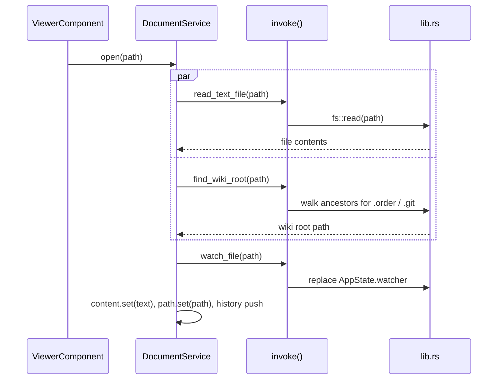

# Tauri commands

All commands are registered once in `lib.rs`'s `invoke_handler!` and given a typed
wrapper on the frontend in `src/app/core/file/backend.ts`, so nothing outside that file
calls `invoke()` directly.

| Command             | Rust signature                                   | Called from                    | Purpose |
| -------------------- | ------------------------------------------------- | ------------------------------- | ------- |
| `take_pending_file`  | `() -> Option<String>`                            | `AppComponent` (startup)        | Drains a path queued by CLI args / file association / second instance. |
| `read_text_file`     | `(path: String) -> Result<String, String>`        | `DocumentService.open/reload`   | Reads a file as UTF-8 (lossy). |
| `write_text_file`    | `(path: String, content: String) -> Result<(), String>` | `DocumentService.write` (editor) | Atomic write (temp file in the same folder, then rename). Only a note file below the vault root (set by `find_vault_root`) or in the folder of the open note (set by `watch_file`); refuses symlinks and notes over 5 MB. |
| `create_file`        | `(path: String) -> Result<(), String>`            | `VaultOpsService`               | Creates an empty file; never overwrites. Only below the vault root (symlinks resolved, `..` refused). |
| `create_dir`         | `(path: String) -> Result<(), String>`            | `VaultOpsService`               | Creates a folder and its missing parents below the vault root. |
| `rename_path`        | `(from: String, to: String) -> Result<Vec<Change>, String>` | `VaultOpsService.rename`       | Moves a file or folder inside the vault; refuses to replace, to move a folder into itself and any path outside the root. Rewrites the links to the moved files in the notes that refer to them (`vault/relink.rs`) and returns those notes. |
| `relink_preview`     | `(from: String, to: String) -> Result<Vec<Change>, String>` | `VaultOpsService.rename`       | The notes a rename would rewrite (`path`, `links`); changes nothing. Used for the confirmation of a folder rename. |
| `trash_path`         | `(path: String) -> Result<String, String>`        | `VaultOpsService.trash`         | Moves to `.trash/` at the vault root (Obsidian's default), numbering a taken name; returns the new path. |
| `new_note_location`  | `() -> Result<NewNoteLocation, String>`           | `VaultOpsService.newNoteFolder` | `newFileLocation` / `newFileFolderPath` of `.obsidian/app.json`; the vault root when missing. |
| `is_utf8_file`       | `(path: String) -> bool`                          | `EditorService.toggle`          | The editor refuses notes with invalid UTF-8 (`read_text_file` replaces those bytes). |
| `is_file`            | `(path: String) -> bool`                          | `ViewerComponent` (link resolve), `AppComponent` | Existence check for link targets. |
| `is_dir`             | `(path: String) -> bool`                          | `AppComponent.openPath`         | Decides file vs. folder when opening a dropped/CLI path. |
| `list_dir`           | `(path: String) -> Result<Vec<DirEntry>, String>` | `WorkspaceService.load`         | One folder level for the sidebar tree. |
| `find_wiki_root`     | `(path: String) -> String`                        | `DocumentService.open`          | Topmost `.order` ancestor, for `/absolute` links and images. |
| `watch_file`         | `(path: String) -> Result<(), String>`            | `DocumentService.open`          | (Re-)starts the live-reload watcher for the current file. |
| `git_vault_status`   | `() -> Result<Option<GitStatus>, String>`         | `GitService.refresh`            | Branch, changed/added/deleted files and ahead/behind of the vault's repository (`git.rs`, libgit2 behind the `GitBackend` trait); `None` when the vault root is not itself a Git repository, so the UI shows no Git. |
| `git_vault_commit`   | `(message: Option<String>, name: Option<String>, email: Option<String>) -> Result<String, String>` | `GitService.commit` | Stages all changes (including deletions) and commits; the message defaults to `vault backup: <timestamp>` (UTC). The author comes from the Git config, else from `name` and `email` (the settings). Refuses an empty commit. |
| `git_token_status`   | `(host: String) -> Result<bool, String>` | `GitService.refreshToken` | Whether an HTTPS access token is stored for the remote host. The token itself is never returned. |
| `git_token_set`      | `(host: String, token: String) -> Result<(), String>` | `GitService.saveToken` | Stores or replaces the token in the OS keychain (macOS Keychain, Windows Credential Manager, Secret Service; crate `keyring`, service `dev.nixe.app.git`, one entry per host). Refuses an empty token. |
| `git_token_delete`   | `(host: String) -> Result<(), String>` | `GitService.deleteToken` | Removes the token of the host; succeeds when none is stored. |

A remote operation (`credentials.rs`, `gitsync::with_auth`) fails with `auth-required:<host>` when no token is stored (before it touches the network) and with `auth-failed:<host>` when the server rejects the token. `GitService.runRemote` catches both, asks for a token in the Git panel and runs the operation again. The token is never logged or shown, and never written to the vault or a settings file.

## Example: opening a file

`read_text_file` and `find_wiki_root` are fired with `Promise.all` — they're
independent, so there is no reason to serialize them.

## Error handling

Commands that can fail (`read_text_file`, `list_dir`, `watch_file`) return
`Result<T, String>`; Tauri turns the `Err` branch into a rejected Promise on the JS
side. `AppComponent.run()` is the single place that catches these and turns them into
the toast notification shown at the bottom of the window — there's no per-call
try/catch scattered through the services.
