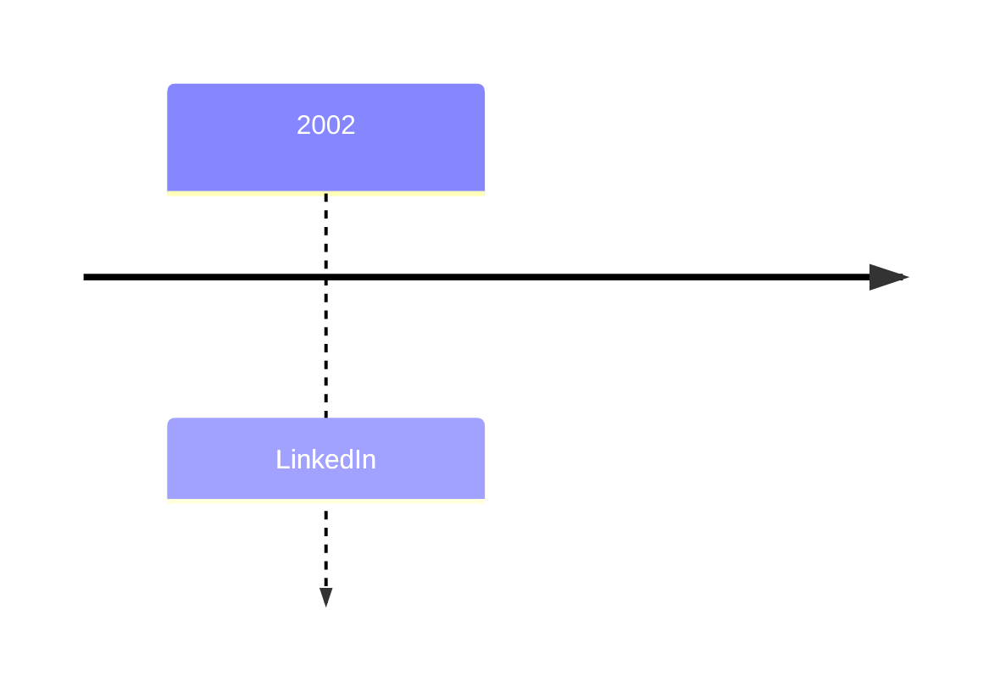

# Export and print

One note for someone else. The command palette has three commands for the open note:

| Command | Does |
|---|---|
| Export as HTML | Asks for a file and writes one self-contained page. |
| Export as PDF | Opens the print dialog with the print stylesheet; choose "Save as PDF" there. |
| Print (`Ctrl/⌘+Alt+P`) | The same print dialog, for paper. |

`nixe export <note> --format html|pdf` does the same from the terminal, see [cli.md](cli.md#export).
With `--out <file>` it also writes a PDF [without the print dialog](#pdf-without-the-print-dialog),
and `nixe export <folder> --format pdf --out <dir>` writes a [folder as PDFs](#folder-as-pdfs).

## What the page contains

- Styles, images, the diagrams (Mermaid, as SVG) and the math (KaTeX, with its fonts) are inlined: the
  file has no script and no link to another file. Remote images keep their address.
- `![[embeds]]` of notes, headings and blocks are resolved like in the viewer.
- Wikilinks become plain text; Markdown links keep their address.
- Comments (`%%…%%`) never appear: the renderer drops them before the export sees the note.
- The properties panel and the viewer's controls (copy buttons) are left out.

## Wide timelines

A Mermaid `timeline` has one column per period, so a long one becomes unreadable when it is scaled to
the page. Every export (HTML, PDF, print) measures it: the content width of the page (the page size
setting minus the `@page` margins, portrait) divided by the width of the diagram's `viewBox`. When
the 16 px labels would come out below 9 px (a scale below about 0.56), the timeline is written
vertically instead: the title, the sections as headings in their colour, and one row per period with
the period on the left and its events as a list on the right. It wraps across pages like text; a
period is never split. The viewer is unchanged (horizontal, scrollable).

A comment in the Mermaid block forces one layout:

`%% nixe: horizontal` keeps the diagram. The comment stands on its own line.

## Print stylesheet

Export as PDF, Print and the `@media print` block of the HTML page share one stylesheet: no app
chrome (the page is printed from its own frame), the page size as `@page`, no break inside code,
tables, images and diagrams, and a page break before every top-level heading (`h1`) except the first
one.

## PDF without the print dialog

`nixe export <note> --format pdf --out <file>` renders the note in the hidden export window as for
HTML, shows the finished document there, waits for its images and fonts and lets the web view print it
into `<file>`: WebView2 `PrintToPdf` on Windows, a print operation without panels on macOS (11 or
later), a print-to-file operation on Linux. Page size, dark or light, page breaks and the print
stylesheet apply. The PDF has no header or footer. The file is written beside the target first, so a
failed export leaves an existing file as it was.

On Linux the export loads only the file backend of GTK printing, so it never reaches a printer. It
needs a display; on a machine without one run it under `xvfb-run`.

### What each web view honours of `@page`

Measured by giving the web view a paper (Legal) and margins (40 mm) that differ from the CSS rule
(`@page { size: A5; margin: 18mm }`). Nixe passes the page size and the 18 mm margin to the web view
as well, so the paper and the margins are the same on all three.

| Platform | `@page size` | `@page margin` | Paper and margins are set by |
|---|---|---|---|
| Windows (WebView2) | lays out the page box in this size and centres it on the paper of the print settings | wins over the print settings | print settings (paper), CSS (page box and margins) |
| macOS (WKWebView) | ignored: the text fills the paper of the print info | wins over the print info | print info (paper), CSS (margins) |
| Linux (WebKitGTK) | ignored | ignored | GTK page setup |

Other differences:

- Dark look: on macOS and Linux the margins of the page stay white and the dark background of the
  last page ends with its content. On Windows the margins are dark grey.
- Fonts come from the system, so line and page breaks can differ between the platforms.

## Folder as PDFs

`nixe export <folder> --format pdf --out <dir> [--include <glob>]... [--exclude <dir>]...` writes one
PDF per note of a folder (a vault, or a part of it), each as [above](#pdf-without-the-print-dialog).

- `folder/sub/Note.md` becomes `<dir>/sub/Note.pdf`: the path below the exported folder is kept.
  `--out .` writes each PDF next to its note instead.
- `--include` keeps the notes whose file name (not the path) matches the glob, for example
  `--include "* – Zusammenfassung.md"`; repeated, any of the globs is enough. The match is case
  sensitive. Quote the glob so that the shell leaves it alone.
- `--exclude` and `publish: false` leave notes out as in the [site export](#folder-as-a-static-site);
  `.gitignore`d files are left out too.
- Nixe starts once for the whole folder. stderr gets one line per note (`nixe: [2/5] sub/Note.md`,
  with `failed: <reason>` when it failed), stdout the path of every written PDF.
- A note that fails does not stop the others; the command then exits `1`. Two notes that would write
  the same PDF (`A.md` and `A.markdown`) count as such a failure for the second one. A folder with no
  note to export exits `0` without starting the app.

## Settings

Settings, section "Export and print" (`settings.json`):

| Setting | Key | Default |
|---|---|---|
| Page break before top-level headings | `exportPageBreaks` | on |
| Dark look | `exportDark` | off |
| Page size (A3, A4, A5, Letter, Legal) | `exportPageSize` | A4 |

## Folder as a static site

The command "Export folder as site" (it asks for the folder and for where to write) and
`nixe export <folder> --site <out> [--exclude <dir>]...` write a vault, or a part of it, as a website:

- One HTML page per note (`folder/Note.md` becomes `folder/Note.html`), with the frontmatter left out.
  A top-level `index.md` is the home page; without one, `index.html` lists the notes.
- `[[wikilinks]]` and Markdown links to notes become links between the pages, headings included.
  A link to a note that is excluded, missing, ambiguous or outside the exported folder is plain text.
  `![[image]]` shows the image; other embeds become a link. Files a page shows or links are copied.
- Every page has the navigation tree of all pages, the backlinks of the note, and a search box
  (`_nixe/search-index.js` and `_nixe/search.js`, no server).
- Excluded: a folder named by `--exclude` (relative to the exported folder or to the vault) and every
  note with `publish: false` (or `no`) in its frontmatter.
- Every link is relative and the output has no server part: it works from a subpath (GitHub Pages) and
  from `file://`. The file `.nojekyll` keeps GitHub Pages from dropping the `_nixe` folder.
- Raw HTML in a note is shown as text. Mermaid diagrams stay code blocks, math stays source text and
  embedded notes become links.

## Limits

- A PDF is made by the system web view, not by Nixe. In the app, "Export as PDF" opens its print
  dialog; only the command line writes a PDF without it.
- On Windows, `nixe export` from the command line lays out a Mermaid flowchart far too wide, in HTML
  and PDF, so its labels become tiny (seen with the WebView2 of a CI runner). macOS and Linux draw it
  as the app does.
- In a development build (`pnpm tauri dev`) the KaTeX fonts come from the dev server and are not
  inlined; a release build embeds them.
