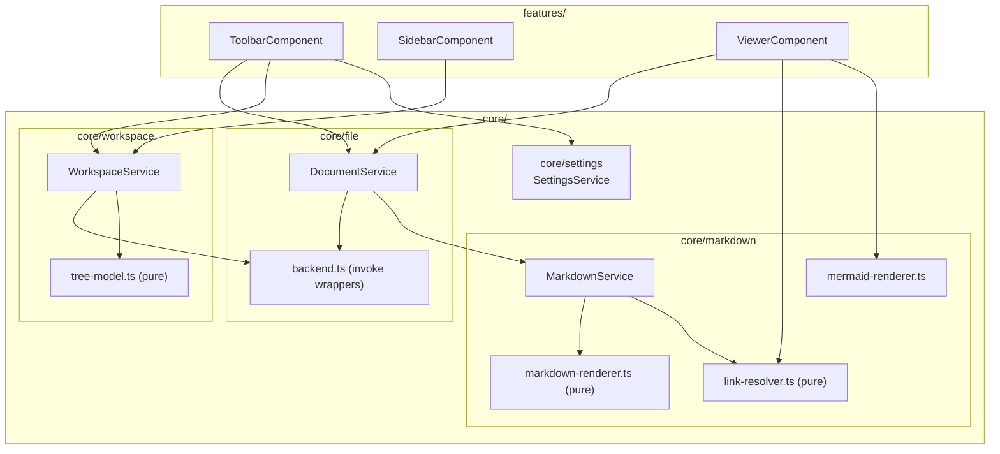

# Frontend (`src/app/`)

Angular, standalone components, [signals](https://angular.dev/guide/signals) for all
state — no NgRx/RxJS store. `core/` holds framework-light services and pure logic;
`features/` holds the three UI components that make up the window.

## The framework-free core

`core/markdown/*` (except `markdown.service.ts`) and `core/workspace/tree-model.ts`
depend on neither Angular nor Tauri — they're plain functions/classes tested with
Vitest (`*.spec.ts` next to the source). That's what makes the
[VS Code extension outlook](../../README.md#outlook-vs-code-extension) in the top-level
README possible: that code could move into its own package unchanged.

## Services

| Service | State it owns | Notes |
| --- | --- | --- |
| `DocumentService` | `path`, `content`, `wikiRoot`, back/forward `history` | The single displayed document. |
| `WorkspaceService` | `root`, the lazily-loaded tree (`visible` computed) | The opened folder's sidebar tree. |
| `MarkdownService` | render cache (one `MarkdownIt` instance per math on/off) | Pure `render()`, see [markdown-pipeline.md](markdown-pipeline.md). |
| `SettingsService` | theme, math toggle, sidebar width/visibility, last folder | Persisted to `localStorage`. |

See [state-management.md](state-management.md) for how these interact when the user
clicks a link or expands a tree node.
