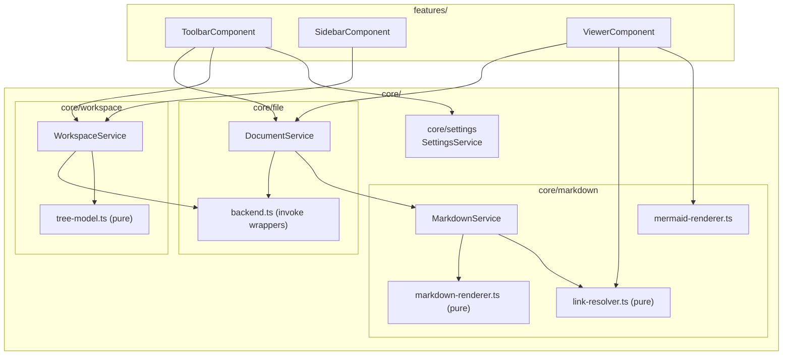

# Frontend (`src/app/`)

Angular, standalone components, [signals](https://angular.dev/guide/signals) for all
state — no NgRx/RxJS store. `core/` holds framework-light services and pure logic;
`features/` holds the three UI components that make up the window.

## The framework-free core

`core/markdown/*` (except `markdown.service.ts`) and `core/workspace/tree-model.ts`
depend on neither Angular nor Tauri — they're plain functions/classes tested with
Vitest (`*.spec.ts` next to the source). That's what makes the
[VS Code extension outlook](../../README.md#outlook-vs-code-extension) in the top-level
README possible: that code could move into its own package unchanged.

## Services

| Service | State it owns | Notes |
| --- | --- | --- |
| `DocumentService` | `path`, `content`, `wikiRoot`, back/forward `history` | The single displayed document. |
| `WorkspaceService` | `root`, the lazily-loaded tree (`visible` computed) | The opened folder's sidebar tree. |
| `MarkdownService` | render cache (one `MarkdownIt` instance per math on/off) | Pure `render()`, see [markdown-pipeline.md](markdown-pipeline.md). |
| `IndexService` | vault index `status`, a `revision` counter bumped on `vault-changed` | Listens to the `index-status` and `vault-changed` events. |
| `BacklinksService` | backlinks and outgoing links of the open note | Feeds the right-hand `BacklinksComponent` panel (View → Toggle Backlinks Panel, ⌘⇧B). Backlinks carry the linking line; clicking one opens the note scrolled to it. Unresolved outgoing links are marked. |
| `SearchService` | vault-wide full-text search | Feeds the left-hand `SearchComponent` panel (View → Search Vault, ⌘⇧F / Ctrl+⇧+F). Results are grouped by note with highlighted snippets; clicking a snippet opens the note at its line. Operators: `tag:#name` (also nested tags), `path:folder/`, `"exact phrase"`; other words match as prefixes. Clicking a `#tag` in a note or the properties panel opens the search with `tag:#name`. The Rust side is `index/search.rs` (command `search_notes`). |
| `SwitcherService` | quick switcher state | Opened with ⌘/Ctrl+O (File → Quick Switcher; Open file moved to ⌘/Ctrl+⇧+P). Notes come from the index (`notes` command, with aliases), falling back to the vault file list. Matching is pure TypeScript in `core/switcher/fuzzy.ts` over file names and aliases; recently opened notes win ties and lead with an empty query. Enter with no match does nothing yet. |
| `OutlineService` | headings of the open note, `topLine` of the viewer or editor, the editor's live text | Feeds the right-hand `OutlineComponent` (View → Toggle Outline Panel, ⌘⇧L). Headings are the ATX headings outside frontmatter and fenced code (`core/outline/outline-core.ts`), nested by level. A click scrolls the viewer (through `DocumentService.pendingLine`) or the editor (`EditorHandle.scrollToLine`). The viewer and the editor report their first visible line on scroll, which highlights the current heading; the editor also reports its text while typing, so the panel follows before the note is saved. Setext headings (underlined) are not listed. |
| `SettingsService` | theme, math toggle, sidebar width/visibility, backlinks and outline panel visibility, last folder | Persisted to `localStorage`. |

### Properties panel

`PropertiesComponent` sits above the note in the viewer and edits the frontmatter in place: one control per type (text, number, checkbox, date, list), chip inputs for `tags` and `aliases` that complete from the index (`tags` and `notes` commands), and add, rename and remove of properties. A change goes through `editFrontmatter` (`core/markdown/frontmatter-edit.ts`), which edits only the lines of the changed key, so key order, comments and the formatting of the other keys stay as they are, and then through `DocumentService.write`. A note without frontmatter gets one with the first property added; a frontmatter that is not valid YAML is shown as an error and not edited.

See [state-management.md](state-management.md) for how these interact when the user
clicks a link or expands a tree node.

## Commands and the command palette

Every action of the app is a `Command` (`id`, `title`, optional `shortcut`, optional `when`
condition) in the `CommandRegistry` (`src/app/core/commands/`). `AppComponent` registers the
built-in ones. The native menu only emits a command id (`menu` event), the webview key handler
runs the commands that declare `keys`, and the palette (⌘/Ctrl+P) lists the commands whose
`when` holds, ranked by fuzzy match on the title, with their shortcuts. Plugins will register
into the same registry.
