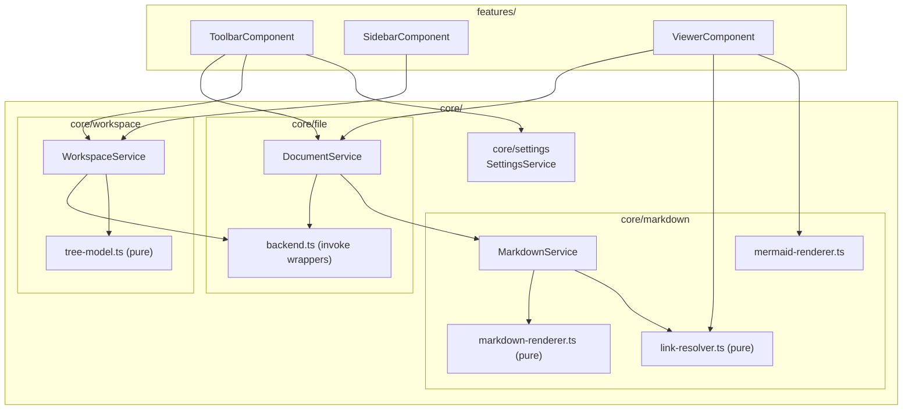

# Frontend (`src/app/`)

Angular, standalone components, [signals](https://angular.dev/guide/signals) for all
state — no NgRx/RxJS store. `core/` holds framework-light services and pure logic;
`features/` holds the three UI components that make up the window.

## The framework-free core

`core/markdown/*` (except `markdown.service.ts`) and `core/workspace/tree-model.ts`
depend on neither Angular nor Tauri — they're plain functions/classes tested with
Vitest (`*.spec.ts` next to the source). That's what makes the
[VS Code extension outlook](../../README.md#outlook-vs-code-extension) in the top-level
README possible: that code could move into its own package unchanged.

## Services

| Service | State it owns | Notes |
| --- | --- | --- |
| `DocumentService` | `path`, `content`, `wikiRoot`, back/forward `history` | The document of one tab. The app-wide instance follows the shown tab of the focused pane (see [Tabs and split view](state-management.md#tabs-and-split-view)). |
| `TabsService` | panes, their tabs, the focused pane, the divider ratio | Every tab owns a `DocumentService`, `EditorService` and `OutlineService`. |
| `WorkspaceService` | `root`, the lazily-loaded tree (`visible` computed) | The opened folder's sidebar tree. |
| `MarkdownService` | render cache (one `MarkdownIt` instance per math on/off) | Pure `render()`, see [markdown-pipeline.md](markdown-pipeline.md). |
| `IndexService` | vault index `status`, a `revision` counter bumped on `vault-changed` | Listens to the `index-status` and `vault-changed` events. |
| `BacklinksService` | backlinks and outgoing links of the open note | Feeds the right-hand `BacklinksComponent` panel (View → Toggle Backlinks Panel, ⌘⇧B). Backlinks carry the linking line; clicking one opens the note scrolled to it. Unresolved outgoing links are marked. The section *Unlinked mentions* starts collapsed and is read when opened: the Rust index (`unlinked_mentions`) searches the other notes for the title or an alias of the note as plain text, skipping code, comments, frontmatter and existing links; the *Link* button of a mention rewrites it to `[[Title]]` (`[[Title\|text]]` when written differently) in that note (`link_mention`), and refuses when the note changed meanwhile. |
| `SearchService` | vault-wide full-text search | Feeds the left-hand `SearchComponent` panel (View → Search Vault, ⌘⇧F / Ctrl+⇧+F). Results are grouped by note with highlighted snippets; clicking a snippet opens the note at its line. Operators: `tag:#name` (also nested tags), `path:folder/`, `"exact phrase"`; other words match as prefixes. Above the results the panel shows `n results in m notes`; a selector sorts by relevance, name or modified time (the choice is kept in `localStorage`), the fold button of a note hides its snippets and the button in the summary folds all notes at once. The `?` button lists the operators; a click inserts one into the query. Hits carry `modified` (ms since epoch, from the index). Clicking a `#tag` in a note or the properties panel opens the search with `tag:#name`. With several roots in the window (#117) the panel searches all of them (`search_workspace`), shows the root of each hit and offers `root:name`. The Rust side is `index/search.rs` (commands `search_notes`, `search_workspace`). |
| `PaletteService` | the one overlay (`PaletteComponent`) for notes, commands, headings, tags, templates and recent vaults | The first character of the input picks the mode: no prefix finds notes, `>` commands, `@` headings of the open note, `#` tags (choosing one opens the search with `tag:#name`), `/` templates, `~` recent vaults; the empty input shows the prefixes as hints. Deleting the prefix changes the mode and keeps the overlay open. With an empty query the recently used entries lead (recent notes, recently run commands, recently inserted templates). ⌘/Ctrl+O opens it for notes, ⌘/Ctrl+P with `>`; the commands `insert-template` (`/`) and `open-recent` (`~`) open it in their mode. |
| `SwitcherService` | the notes the palette finds | Notes come from the index (`notes` command, with aliases), falling back to the vault file list. Matching is pure TypeScript in `core/switcher/fuzzy.ts` over file names and aliases; recently opened notes win ties and lead with an empty query. Enter with no match creates the note. `recentNotes` feeds the start page. |
| `RelatedService` | notes close to the open note | Feeds `RelatedComponent`, the *Related* tab of the right panel (command *Toggle related notes panel*; the tab shares the stored backlinks flag with *Links*, so a restart reopens the panel on *Links*). The ranking is computed in the Rust index (`related_notes`, `index/read.rs::related`): per candidate note the score adds *links both ways* 100 (or *links here*, a backlink, 60; or *linked from here*, an outgoing link, 50), 15 for each note (at most 3) that links to both the open note and the candidate (*both linked from X*, `X and n more`), and 5 per shared tag (at most 5, *n shared tags*). Entries are sorted by score, then path, and limited to 50; targets that are no note are skipped. Each entry shows its reasons, strongest first; hover shows the link preview, a click opens the note (⌘/Ctrl: new tab). |
| `OutlineService` | headings of the open note, `topLine` of the viewer or editor, the editor's live text | Feeds the right-hand `OutlineComponent`, the *Outline* tab of the right panel next to the *Links* tab (the toggle commands select their tab, and toggling the open tab closes the panel; the tab is kept in the vault state as the outline or backlinks visibility) (View → Toggle Outline Panel, ⌘⇧L). Headings are the ATX headings outside frontmatter and fenced code (`core/outline/outline-core.ts`), nested by level. A click scrolls the viewer (through `DocumentService.pendingLine`) or the editor (`EditorHandle.scrollToLine`). The viewer and the editor report their first visible line on scroll, which highlights the current heading; the editor also reports its text while typing, so the panel follows before the note is saved. Setext headings (underlined) are not listed. The outline folds: the buttons H1, H2, H3 and All fold to a level or expand everything, and a heading with children has its own fold button; while a folded heading hides the current one, it is marked instead. The folds belong to the note. The right panel is resized by its left edge (`PanelResizerComponent`, `role="separator"`, a 6px grab area, arrow keys, Home/End); the width is `SettingsService.panelWidth`, kept in the vault state, and limited so the note keeps 320px (`core/panel/panel-width.ts`). In a window too narrow for both, the panel overlays the note. |
| `SettingsService` | theme, math toggle, sidebar width/visibility, backlinks and outline panel visibility, last folder, recent vaults and their saved state | Persisted to `localStorage`. |

### Properties panel

`PropertiesComponent` sits above the note in the viewer and edits the frontmatter in place: one control per type (text, number, checkbox, date, list), chip inputs for `tags` and `aliases` that complete from the index (`tags` and `notes` commands), and add, rename and remove of properties. A change goes through `editFrontmatter` (`core/markdown/frontmatter-edit.ts`), which edits only the lines of the changed key, so key order, comments and the formatting of the other keys stay as they are, and then through `DocumentService.write`. A note without frontmatter gets one with the first property added; a frontmatter that is not valid YAML is shown as an error and not edited.

### Task checkboxes

A click on a task checkbox in the reading view writes `- [ ]` / `- [x]` to the file: the renderer gives every task item its source line (`data-line`), the viewer enables the checkboxes and `setTaskState` (`core/markdown/task-toggle.ts`) changes only that one character, then `DocumentService.write` saves it atomically. The viewer skips the re-render that follows its own write, so nothing jumps or reloads. Other markers such as `- [/]` are never touched. A checkbox inside an embed (`![[Note]]`, a heading or a block) writes to the embedded note: the expander records its file and the line offset of the shown part on `.embed-body`. Piped stdin content stays read-only.

A click on an image in the reading view opens it in the zoom dialog that Mermaid diagrams use (buttons, wheel zoom, drag to pan, Escape closes). The image is sized by `width`/`height`, never by a transform, so an SVG is drawn again at every zoom level and stays sharp. `decorateImages` (`core/markdown/image-zoom.ts`) makes images outside links focusable (Enter opens) and the stylesheet gives them a zoom-in cursor. An image inside a link follows the link; its dialog is in the context menu (*Open image*). For a local image the dialog also offers *Open with default app* and *Reveal in Finder/Explorer* (the file path is recovered from the asset URL by `assetFilePath`).

See [state-management.md](state-management.md) for how these interact when the user
clicks a link or expands a tree node.

## Commands and the command palette

Every action of the app is a `Command` (`id`, `title`, optional `shortcut`, optional `when`
condition) in the `CommandRegistry` (`src/app/core/commands/`). `AppComponent` registers the
built-in ones. The native menu only emits a command id (`menu` event), the webview key handler
runs the commands that declare `keys`, and the palette (⌘/Ctrl+P, the `>` mode of the one overlay) lists the commands whose
`when` holds, ranked by fuzzy match on the title, with their shortcuts; the ones run last come first. Plugins will register
into the same registry.

Every command can get a shortcut of the user's choice (Settings → Shortcuts). `ShortcutService`
(`core/commands/shortcut.service.ts`) records a key press (`bindingFromEvent` in `shortcuts-core.ts`
normalizes it: `Mod` is ⌘ on macOS and Ctrl elsewhere, ⌥ letters are read from the physical key),
shows conflicts before saving and stores only the differences from the defaults as `shortcuts` in
`settings.json` of the app config directory, never in the vault. The overrides replace the `keys`
of the webview key handler (`CommandRegistry.overrides`) and are sent to the native menu
(`set_menu_shortcuts`), so the menu shows the changed shortcuts. While a shortcut is recorded the
menu accelerators are off, so the pressed keys do not run commands.

## Note history

The sidebar view `history` (needs a Git vault; command `note-history`) lists the commits that touched the open note, the uncommitted state first (`HistoryService`, `features/history`). Older commits load in pages of 50 when the list is scrolled to its end. One selected entry shows its change against its parent (the uncommitted state against HEAD); two show the difference between them. `core/git/line-diff.ts` computes the line-based diff with word-level highlighting for paired lines; the view has a source mode (the diff) and a rendered mode (both versions rendered side by side).

Each commit row offers `Restore this version`, which writes that commit's text into the open note through the atomic write (`write_text_file`) as a new change in the Git status; the history is never rewritten. `Copy` puts the selected part of the diff or rendered versions on the clipboard, else the whole version. Below the timeline, `Deleted notes` lists the notes the last 50 commits deleted (`git_deleted_notes`); `Restore` recreates one with its last content and refuses when a file of that name exists.

### Changes since the last sync

`git_vault_sync` reports `pulledFrom`, the commit HEAD was at before a pull that brought changes. `GitService.lastPull` keeps it and `ChangesService` lists the notes between that commit and HEAD (`git_changes_between`). The status bar then offers `n notes changed`, which opens the Git view; its `Changes since` section lists the changed, added and deleted notes with a line diff each (`ChangesComponent`) and switches the range to last sync, yesterday (`git_rev_at`, 24 hours ago) or a commit id. The notes of the last pull carry a dot in the file tree until they are opened. All of this lives in memory only: a restart forgets the last pull.

### Review of agent branches

`ReviewService` lists the branches that wait for review (`git_review_branches`): local and remote branches named with the setting `reviewBranchPrefix` (Settings > Git, default `claude/`; empty turns it off) that are ahead of the working branch. It reads again when the Git status, the index or the prefix changes, so a sync that fetches a new branch shows it. The status bar offers `n branches to review`, which opens the Git view; its `Review` section (`ReviewComponent`) shows author, date, commit messages and the number of changed notes per branch. Opening a branch lists its notes against the merge base with HEAD (`git_review_changes`); a note shows the diff of the history view, source or rendered. The *Hunks* view lists the blocks of changed lines (`git_review_hunks`); every note and every hunk is accepted or rejected, and an accepted hunk can be edited first. The decisions are saved per branch and tip (`git_review_state_save`), so an unfinished review survives a restart. *Finish review* asks, then commits the accepted changes (`git_review_finish`) and deletes the branch locally and on the remote; notes that conflict with changes made in the vault since are shown with both versions and need a decision. The convention for the agent is in [`docs/ai-review.md`](../ai-review.md).

While a note is edited, the status bar shows its words and characters, or those of the selection (`EditorService.stats`, `countText` in `core/editor/text-stats.ts`). Frontmatter, `<!-- -->` and `%% %%` comments and fenced code blocks do not count; the title attribute shows the reading time at 200 words a minute. The editor recounts 150 ms after the last change or selection change.

With a vault and an open note the status bar shows `n backlinks` (`BacklinksService.backlinks`); a click opens the Links tab of the right panel. The bar reads the lists itself (the panel only while it is mounted) and again whenever the index changes.

## Start page

`StartComponent` (`features/start`) is the page of the empty tab, in the shell while there is only one empty tab and in the pane of every other empty tab. Without a vault it shows Open folder, Clone vault, Open file and the recent vaults; in a vault it shows the daily note, New note and Quick switcher, each with its current shortcut (`ShortcutService.display`), and the recently opened notes. The actions run commands of the `CommandRegistry`; the palette lists the other shortcuts.

The conflict bar (`ConflictBarComponent`, #242) above a note with a sync conflict offers *Merge* next to *Keep this one* and *Keep the other*. *Merge* (`ConflictMergeComponent`, an `hx-dialog`) shows both versions as shared lines and hunks marked like the review's hunk view; each hunk is taken from this note, the other one or both, and the result can be edited. *Save* writes the original, moves the copy to `.trash/` (which clears the conflict mark) and opens the original; *Cancel* changes nothing. No new command: it uses `write_text_file` and `resolve_conflict`.
