# Markdown → HTML pipeline

`MarkdownService.render()` is the only place Markdown becomes HTML. It's a pure
function of `(text, RenderContext)` — no Angular DI beyond what's needed to register
the DOMPurify hook once in the constructor — which is why it's covered by
`markdown-renderer.spec.ts` without a TestBed.

```mermaid
flowchart LR
    Text["Raw Markdown text"] --> MDIt["markdown-it"]

    subgraph plugins["markdown-it plugins (createMarkdownRenderer)"]
        Anchor["markdown-it-anchor\n(GitHub/ADO-style slugs)"]
        Footnote["markdown-it-footnote"]
        Tasks["markdown-it-task-lists"]
        AdoMermaid["adoMermaidPlugin\n(ADO ::: mermaid ::: block)"]
        MermaidFence["mermaidFencePlugin\n(mermaid fence → pre.mermaid)"]
        AdoToc["adoTocPlugin\n(TOC placeholder)"]
        SourceLine["sourceLinePlugin\n(data-line for scroll sync)"]
        Katex["katex plugin (optional)"]
    end

    MDIt --> Anchor --> Footnote --> Tasks --> AdoMermaid --> MermaidFence --> AdoToc --> SourceLine
    SourceLine -. "if math enabled" .-> Katex

    SourceLine --> RawHtml["Unsanitized HTML string"]
    Katex --> RawHtml
    RawHtml --> Purify["DOMPurify.sanitize()"]
    Purify -- "afterSanitizeAttributes hook" --> Images["<img src> rewritten to\nconvertFileSrc(...)"]
    Images --> Sanitized["Sanitized HTML"]
    Sanitized --> Viewer["ViewerComponent: el.innerHTML = html"]
    Viewer --> MermaidRender["MermaidRenderer.render()\nreplaces <pre class=mermaid> with SVG"]
```



## Two renderer instances, not one

`createMarkdownRenderer` is only re-invoked when the *math* toggle changes; the
`math: boolean` key doubles as a tiny two-entry cache (`renderers: Map<boolean,
MarkdownIt>`) so toggling LaTeX doesn't rebuild the whole markdown-it pipeline on
every keystroke, only the (rare) toggle itself pays that cost.

## Images: a second, later resolution pass

Local image paths can't be resolved inside markdown-it (it only sees text, not the
current file path). Instead:

1. markdown-it renders `` with the src untouched.
2. DOMPurify's `afterSanitizeAttributes` hook — registered once, reading `this.current`
   (the in-flight `RenderContext`) — rewrites any local `src` to a `convertFileSrc(...)`
   URL, resolved relative to the document's folder, or to `wikiRoot` for a leading `/`.

This is the same classification (`classifyHref` in `link-resolver.ts`) used for `<a>`
clicks, so an image path and a link path follow identical rules (see
[state-management.md](state-management.md) for the click side).

## Mermaid: two dialects in, one renderer out

Both a plain ```` ```mermaid ```` fence and the Azure DevOps wiki's
`::: mermaid ... :::` block (handled by `adoMermaidPlugin`, which rewrites the block
into a regular fence token with info `"mermaid"`) end up as the same
`<pre class="mermaid">` placeholder. `MermaidRenderer` then:

- lazy-loads the `mermaid` package on first use (it's large),
- renders each placeholder to an SVG, **cached by source text** so retyping
  unrelated parts of the document doesn't re-render unchanged diagrams,
- replaces a failing diagram with an error box showing the message *and* the
  offending source, rather than failing the whole render.

The diagram just above this paragraph, and the ones throughout `docs/`, all go through
exactly this path — opening this folder in Nixe is as much an integration test for this
pipeline as it is documentation.
