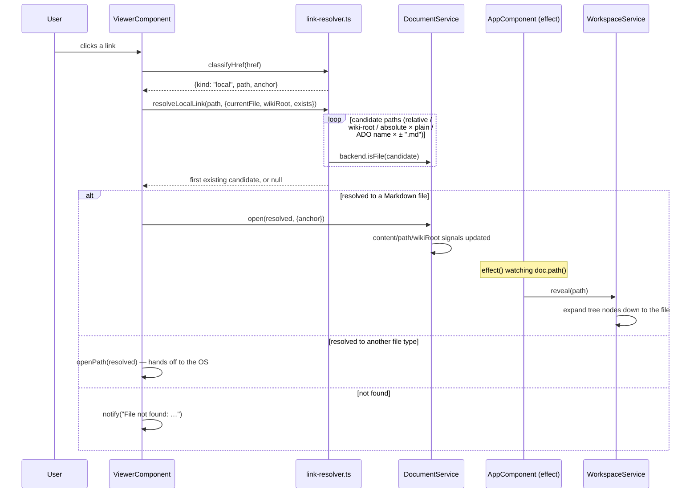
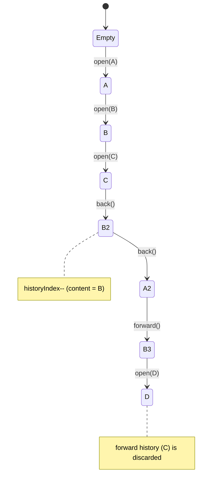

# State management & navigation

There is no central store. Each service owns a handful of `signal()`s, exposes
`computed()`s derived from them, and components read those directly in their
templates — Angular's fine-grained reactivity does the rest.

## Following a link

This is the path most user interaction takes: click a link in the rendered Markdown,
end up on a new document, with the sidebar tree following along.

Two things worth noticing:

- **`resolveLocalLink` tries several candidates in order** — see
  [`localCandidates`](../../src/app/core/markdown/link-resolver.ts) — so the same link
  syntax works whether the target is a plain relative file or an Azure DevOps wiki
  `/Absolute-Page` link with `-`/`%2D` space/hyphen encoding.
- **The tree "follows" navigation passively.** `AppComponent`'s constructor registers
  an `effect()` on `doc.path()` that calls `workspace.reveal()`; `DocumentService` and
  `WorkspaceService` don't reference each other directly. That's also why opening a
  link never has to know whether a folder is even open.

## Back / forward history

`DocumentService` keeps its own `history: string[]` + `historyIndex` — deliberately not
reusing the browser's `History` API, since there's no browser chrome or URL bar to
begin with. `open()` truncates any forward history and appends, matching how browsers
behave when you navigate after going back.

## Persisted vs. ephemeral state

`SettingsService` is the only service that touches `localStorage` (theme, math toggle,
sidebar width/visibility, last opened folder — restored on the next launch via
`AppComponent.initDesktopIntegration`). `DocumentService` and `WorkspaceService` are
pure in-memory state: closing and reopening the app re-derives the tree and the
default page from disk rather than restoring exact scroll/expand state.
