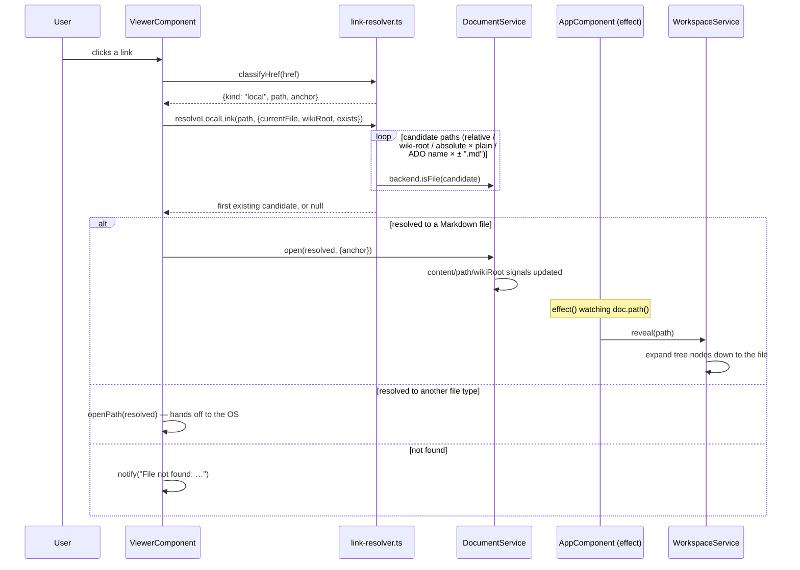
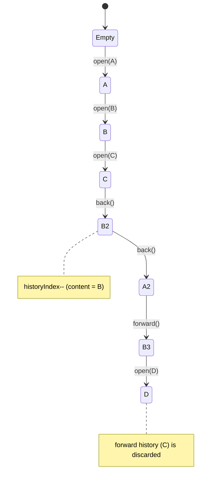

# State management & navigation

There is no central store. Each service owns a handful of `signal()`s, exposes
`computed()`s derived from them, and components read those directly in their
templates — Angular's fine-grained reactivity does the rest.

## Following a link

This is the path most user interaction takes: click a link in the rendered Markdown,
end up on a new document, with the sidebar tree following along.

Two things worth noticing:

- **`resolveLocalLink` tries several candidates in order** — see
  [`localCandidates`](../../src/app/core/markdown/link-resolver.ts) — so the same link
  syntax works whether the target is a plain relative file or an Azure DevOps wiki
  `/Absolute-Page` link with `-`/`%2D` space/hyphen encoding.
- **The tree "follows" navigation passively.** `AppComponent`'s constructor registers
  an `effect()` on `doc.path()` that calls `workspace.reveal()`; `DocumentService` and
  `WorkspaceService` don't reference each other directly. That's also why opening a
  link never has to know whether a folder is even open.

## Back / forward history

`DocumentService` keeps its own `history: string[]` + `historyIndex` — deliberately not
reusing the browser's `History` API, since there's no browser chrome or URL bar to
begin with. `open()` truncates any forward history and appends, matching how browsers
behave when you navigate after going back.

## Persisted vs. ephemeral state

`SettingsService` is the only service that touches `localStorage` (theme, math toggle,
sidebar width/visibility, last opened folder — restored on the next launch via
`AppComponent.initDesktopIntegration`). `DocumentService` and `WorkspaceService` are
pure in-memory state: closing and reopening the app re-derives the tree and the
default page from disk rather than restoring exact scroll/expand state.

### Recent vaults

`SettingsService.recentVaults` holds the last five opened folders, newest first, and
`vaultStates` the open note and the sidebar, backlinks and outline visibility of each of them
(`core/workspace/recent-vaults.ts`). `WorkspaceService.openFolder` saves the state of the vault it
leaves and restores that of the vault it opens (a vault opened for the first time keeps the current
panels and shows its default page). `File → Open Recent…` and the command `open-recent` show the
picker (`RecentPickerService`); a vault whose folder no longer exists is removed from the list and a
message tells so, also at startup.

### Tabs and split view

`TabsService` (`core/tabs/`) holds one or two panes (the second one to the right), each with tabs. A
tab has its own injector with its own `DocumentService`, `EditorService` and `OutlineService`, so
its back/forward history, scroll position and mode (viewer or editor) belong to the tab. `PaneComponent`
is created with that injector (`WorkspaceComponent` uses `ngComponentOutlet`), so the viewer and the
editor inside need no knowledge of tabs.

The app-wide `DocumentService`, `EditorService` and `OutlineService` (`ACTIVE_TAB_PROVIDERS` in
`app.config.ts`) are stand-ins that forward to the shown tab of the focused pane. Everything outside
the panes (backlinks, outline, commands, the toolbar, the vault operations) therefore follows the
focus without change. A click or focus inside a pane focuses it. Only the note of the focused pane
is watched for external changes; the watcher event goes to every tab showing that note.

- Commands: `new-tab` (⌘/Ctrl+T), `close-tab` (⌘/Ctrl+W; closes the window when only an empty tab is
  left), `next-tab` / `previous-tab` (⌃Tab, ⌃⇧Tab), `split-right`, `unsplit`, `focus-other-pane`.
  ⌘/Ctrl+click on a link, a tree entry or a backlink opens the note in a new tab.
- Focus regions: `FocusService` (`core/shell/focus.service.ts`) registers `focus-file-tree` (⌘/Ctrl+Shift+E),
  `focus-note` (⌘/Ctrl+Shift+N) and `focus-panel` (⌘/Ctrl+Shift+I); the shortcuts can be changed like any other.
  A collapsed sidebar or panel opens first. Escape in the sidebar or the panel returns the focus to the note
  (not in a text field, where Escape cancels the edit). While the focus was moved by a command, `<html>` has
  `data-keyboard-focus` (removed on the next pointer press) and the editor, the viewer and the panel tab show a ring.
- Views as tabs: settings and the vault health report are not notes; they open as a tab
  (`TabsService.openView`, at most one of each: the open one is focused, also in the other pane).
  The tab keeps an empty document, so it never reaches the back/forward history; opening a note into
  it turns it into a note tab. `TabState.view` stores it, so it is restored on start. The tab strip of
  each pane is `HxTabBar` (close, reorder, drag between panes, all-tabs menu).
- The same note in two panes: typing in an editor is passed to the other tabs on that note
  (`DocumentService.typed` → `remote`), an editor there applies it as a change that is not saved
  again; a save marks the write as the pane's own so the watcher does not report a conflict.
- Restoring: the tabs, their history, mode, scroll line, the split and the divider are stored in the
  vault state (`VaultState.layout`, `core/tabs/layout.ts`) and opened again by `WorkspaceService.openFolder`;
  notes that are gone are left out.

## Settings

`⌘/Ctrl+,` (command `open-settings`, also in the native menu) opens the settings page.

- **Storage.** App settings are one JSON file, `settings.json` in the app config directory
  (`read_app_settings` / `write_app_settings`, written atomically). `SettingsService.load()` runs
  before the app starts (`provideAppInitializer`). Without a file, the old `localStorage` entry
  (`nixe.settings`) is migrated into it (`loadSettings` in `settings-core.ts`); if the file cannot be
  read, the settings stay in `localStorage` and the file is never overwritten. Every key is
  sanitized, so a missing or wrong-typed key falls back to its default.
- **Sections.** `SettingsRegistry.register()` adds a section (`id`, `title`, `order`, `items()`); the
  built-in ones (General, Editor, Files and links, Appearance, Git, Shortcuts) are in
  `builtin-sections.ts`. Features and plugins register theirs the same way.
- **Obsidian settings** (new-note folder, attachment folder, link format, templates, daily notes) are
  read from `.obsidian/` by `obsidian_settings` and shown read-only with their source file.
- **Apply at once.** Items read and write the `SettingsService` signals, so changes need no restart.
  The search field filters items by label, description, keywords and section title.

## File tree header

The header of the file tree has the buttons New note, New folder, Sort, Reveal the active note and
Collapse all; each is a command of the palette too (`new-note`, `new-folder`,
`sort-file-tree-<order>`, `reveal-active-note`, `collapse-all-folders`). The tree is kept current by
the file watcher, so there is no Refresh button; the command "Reload file tree" reads it again.

Sort offers file name and modified time, ascending and descending (`treeSort` in `settings.json`,
default `name-asc`). Folders stay first. Name ascending keeps the order of the backend, which honors
an Azure DevOps `.order` file. Reveal expands the folders of the open note and scrolls its row into
view (`WorkspaceService.revealActive`).
The button or command only flashes the row for 2 s; the reveal on a tab switch stays quiet.

In a vault with Git a changed note shows a letter at the right of its row (`M` modified, `A`
added, `U` untracked) and its name in the color of the status; a folder with such notes shows a
dot. The status is the one of `GitService.status()`; the colors are `light-dark()` pairs of Helix
tokens whose contrast on the sidebar is checked in `theme-tokens.spec.ts`. The setting "Git status
in the file tree" (`treeGitStatus`, default on) turns it off.

The filter field above the tree (command `filter-file-tree`, "Filter file tree", Ctrl/⌘+Alt+E)
narrows the tree to the notes and folders whose name contains the text, case-insensitive. Matching
parts are highlighted, the folders of the matches are expanded (`WorkspaceService.setTreeFilter`
loads the folders from the vault file list) and Escape clears the field.
