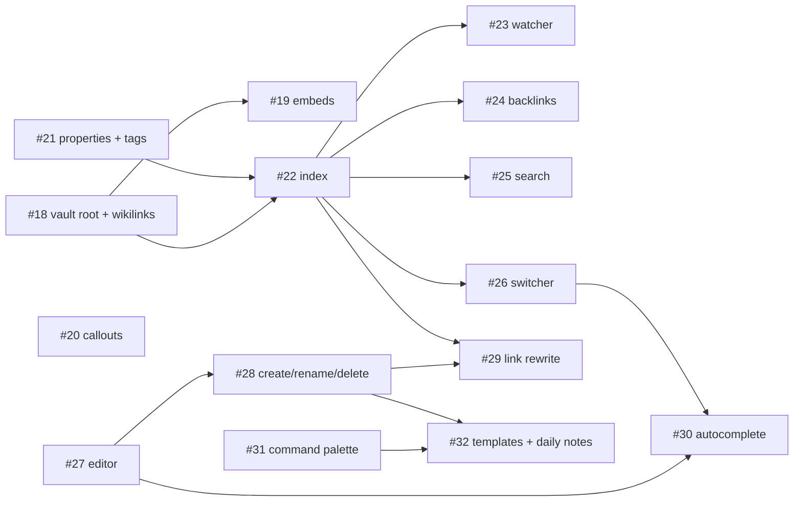

# Roadmap: Nixe as an AI-first knowledge base

Status: Draft, 2026-10-20. Epic: [#9](https://github.com/GravionLabs/nixe/issues/9).
Spec: [0001 AI-first knowledge base](specs/0001-ai-knowledge-base.md),
[0002 Plugin system](specs/0002-plugin-system.md).

## Principles

- **Basics first.** M0–M2 make Nixe usable for daily work on an Obsidian vault. Everything
  that differentiates Nixe (AI review, capture, modes) builds on that and comes after.
- **One grammar.** Obsidian syntax (wikilinks, embeds, callouts, tags, frontmatter) lives in
  the TypeScript Markdown core, which is framework-free and tested with Vitest. Rust does I/O,
  file walking, persistence, full text, Git and the Claude API.
- **Extension points from the start.** The Markdown pipeline, the command registry, panels and
  the index are registries that built-in features use. The plugin system (M5) opens the same
  registries to plugins instead of adding a second mechanism.
- **Obsidian-compatible, not Obsidian-dependent.** Nixe reads `.obsidian/` settings where it
  matters (new-note folder, templates, daily notes) so a vault behaves the same in both apps.
  Plugin compatibility with Obsidian is not a goal.
- **No lock-in.** Plain Markdown, Git, skills and rules in the vault repo.

## Milestones

| Milestone | Outcome | Issues |
|---|---|---|
| **M0 – iOS spike** | Go/no-go for Tauri on iOS and the Git strategy, recorded in an ADR. Time-boxed. | #10 → #17 |
| **M1 – Vault viewer** | Nixe reads an Obsidian vault: wikilinks, embeds, callouts, properties, tags, backlinks, search, quick switcher. | #11 (#18–#21), #12 (#22–#26) |
| **M2 – Vault editor** | Nixe writes: CodeMirror 6 editor, create/rename/delete, link rewrite, autocomplete, command palette, templates, daily notes. **Daily work on a vault is possible.** | #13 (#27–#32) |
| **M3 – Git sync** | Status, commit, pull/push, credentials in the keychain, auto-sync, conflicts, clone. | #14 (to be planned) |
| **M4 – Claude as author** | Claude API client, AI branch with diff review, provenance, vault skills. | #15 (to be planned) |
| **M5 – Plugin system** | Manifest, loader, API v1, settings, registry and installer; recipe mode as the first plugin. | #16 (to be planned) |
| **M6 – Capture and modes** | Mobile capture (dictation, photo), iOS layout and share extension, development mode, librarian. | not yet filed |
| Later | Semantic search through an API, WASM plugins, VS Code extension from the Markdown core. | — |

M0 runs in parallel with M1; only M3 waits for its result. M1 and M2 are strictly the
"Grundfunktionalitäten": after M2 the owner can move the vault from Obsidian to Nixe on the
desktop and keep syncing with the Obsidian Git plugin or the command line until M3 lands.

## Order inside M1 and M2

Unblocked at the start: #17 (spike), #18, #20, #21, #27, #31. The editor (#27) and the
command palette (#31) do not depend on M1 and can be built alongside it.

## Decisions taken for this plan

| Decision | Choice | Why |
|---|---|---|
| Where metadata is parsed | TypeScript Markdown core | One grammar for rendering and index; Vitest-tested; same code later usable by plugins and a VS Code extension. Rust only walks files and stores. ADR to be written in #22. |
| Full-text search | SQLite FTS5 (`rusqlite`, `bundled`) | Already needed for the index cache; no second engine. `tantivy` only if FTS5 is not enough. |
| Fuzzy matching | Frontend, pure TS | Vault sizes of a few thousand notes do not need `nucleo`. |
| Editor | CodeMirror 6, source mode only in M2 | Live preview is a large separate effort; source mode plus the viewer covers daily work. |
| Saving | Autosave with 1 s debounce plus ⌘S | Obsidian behavior; the watcher must ignore own writes. |
| Deleting | Move to `.trash/` in the vault | Obsidian's default; recoverable. |
| Obsidian settings | Read `app.json`, `templates.json`, `daily-notes.json` | A vault behaves the same in both apps during the transition. |
| Plugins | JS in the WebView, Git-based registry, recipe mode as first plugin | See spec 0002. |
| AI branch | Per run (`nixe/ai/<timestamp>`) | Keeps each review small and independent; a long-lived branch would accumulate unreviewed changes. Revisit in M4. |

## Risks

- **iOS.** Tauri iOS and `git2` with vendored OpenSSL are unproven here. M0 exists to find out
  early; the fallback is the GitHub REST API for sync, which still allows M1–M2 on mobile.
- **Two parsers drift.** If a Rust parser is ever added (for example for a CLI), it must reuse
  the same fixtures under `fixtures/vault/`.
- **Watcher feedback loops.** Autosave, index updates and Git pulls all touch the same files.
  #27 and #23 define the suppression rules; test them together.
- **Scope creep in M1.** Obsidian has many more syntax corners (Dataview, canvas, footnote
  styles). The fixture vault defines what is in; everything else waits for a plugin.

## How to work the plan

Each PBI is one branch and one pull request against the integration branch. Plan the next
level with the `planner` agent ("plan issue #14") when a Feature has no PBIs yet, and pick the
next unblocked PBI of the Epic with the `orchestrator` agent. Close the child issue; the native
sub-issue links keep the Feature and Epic progress current.
