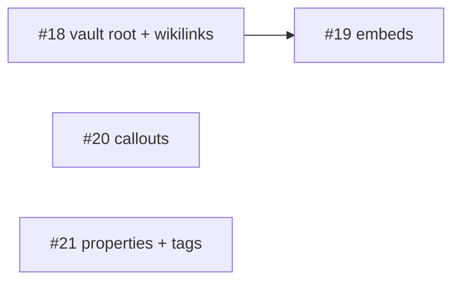

# Roadmap: Nixe as a lean Markdown viewer

Status: 2026-11-01. Epic: [#9](https://github.com/GravionLabs/nixe/issues/9).
Decision: [ADR 0002](adr/0002-nixe-stays-a-lean-markdown-viewer-no-obsidian-rewrite.md).

## Principles

- **Lean and fast.** Nixe is a Markdown viewer. Fast startup and rendering beat feature count.
- **Read-only.** Nixe never writes into the folders it opens. Editing, sync and history stay
  in the editor of choice (Obsidian, VS Code) and Git.
- **One grammar.** Markdown extensions live in the TypeScript Markdown core as markdown-it
  plugins: framework-free, tested with Vitest, reusable for example by a VS Code extension.
  Rust does file I/O, file walking and the watcher.

## Next: Obsidian vault rendering (optional)

Feature [#11](https://github.com/GravionLabs/nixe/issues/11) lets Nixe display an Obsidian
vault the way Obsidian renders it.

| PBI | Content | Size |
|---|---|---|
| #18 | Vault root (`.obsidian/`), in-memory file list, `[[wikilinks]]` and resolver | S |
| #19 | `![[embeds]]` of notes, headings, blocks and images | |
| #20 | Callouts, `==highlights==`, `%%comments%%` | |
| #21 | Frontmatter as properties, `#tags` | M |

Unblocked at the start: #18, #20, #21.

## Out of scope

Vault index, backlinks, full-text search, quick switcher, editor, Git sync, Claude
integration, plugin system and an iOS app. See ADR 0002 for the reasons.

## Risks

- **Scope creep.** Obsidian has many more syntax corners (Dataview, canvas, footnote styles).
  The fixture vault under `fixtures/vault/` defines what is in; everything else is not rendered.
- **Large vaults.** The in-memory file list is built on open. If that gets slow, cache it in
  memory per session; do not add a persistent index.
