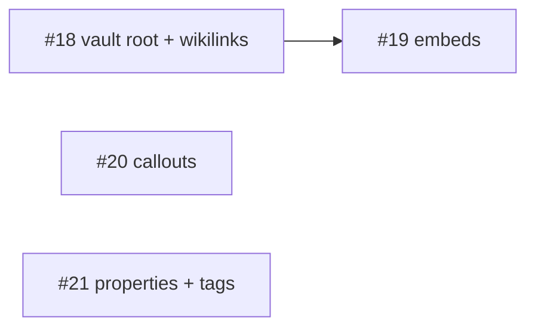

# Roadmap: Nixe as a vault app

Status: 2026-11-15. Epic: [#44](https://github.com/GravionLabs/nixe/issues/44).
Decisions: [ADR 0003](adr/0003-nixe-becomes-a-vault-app-with-editing-and-git-sync.md) (vault app,
supersedes [ADR 0002](adr/0002-nixe-stays-a-lean-markdown-viewer-no-obsidian-rewrite.md)) and
[ADR 0004](adr/0004-tauri-on-ios-go-git2-for-git-sync-native-swift-only-for-file-access-outside-the-sandbox.md)
(Tauri on iOS: go).

## Goal

Nixe grows from a Markdown viewer into a vault app that edits and syncs, on desktop and iOS. It
works on the same plain `.md` files and folder layout as Obsidian, so both apps can use one vault.

## Principles

- **Same format as Obsidian.** Notes are plain `.md` files and `.obsidian/` is never written; the layout of the vault lives in `.nixe/` ([ADR 0007](adr/0007-vault-configuration-in-nixe.md)).
- **One Rust core, thin frontends.** Vault scan, index, search and Git sync live in `src-tauri/`.
- **Two parsers, one fixture vault.** The TypeScript Markdown core renders; the Rust core
  extracts metadata for the index. Both are tested against `fixtures/vault/`.
- **Lazy loading.** Startup stays fast: the editor and the index load on demand.

## Milestones

| Milestone | Content | Features |
|---|---|---|
| M000 | iOS spike (gate): open a vault, edit, sync on a real iPhone. Result: go (ADR 0004) | #49 |
| M001 | Vault viewer: Obsidian rendering and the vault index in the Rust core | #11, #50 |
| M001.1 | Vault editor: CodeMirror 6, source mode with styled Markdown | #51 |
| M001.2 | CLI, MCP and vault health | #87, #88 |
| M003 | Git sync: clone, pull with rebase, auto-commit, push, conflict copies | #52 |
| M003.1 | Git history per note, AI changes as review | #89, #90 |
| M004 | Daily use: templates, daily notes, attachments, editable properties, tabs, settings | #53 |
| M004.1 | Editor and workspace comforts | #91 |
| M004.2 | Workspaces of several folders, quick capture, export | #92, #93, #94 |
| M004.3 | Git view and history for users without Git knowledge, terminal and agent panel | #291, #313, #314 |
| M005 | Live preview | #55 |
| M005.1 | Live preview polish: fixes for tables and frontmatter, text size, folded properties, view modes, table editing | #373 |
| M006 | Bases | #56 |
| M007 | Plugin system, shaped like Obsidian's with partial compatibility | #57 |
| M008 | German UI through i18n | #315 |
| M009 | iOS MVP, sync on open and close | #54 |

M001, M001.1 and M003 together are the desktop MVP: file tree, editor, `[[wikilinks]]` with
backlinks, search and Git sync. M000 gated Git sync and iOS only; the desktop viewer, index and
editor did not wait for it.

### Order of the PBIs

Within a milestone a PBI starts when its blockers are done. The PBIs of Feature #11 (M001):

| PBI | Content | Size |
|---|---|---|
| #18 | Vault root (`.obsidian/`), in-memory file list, `[[wikilinks]]` and resolver | S |
| #19 | `![[embeds]]` of notes, headings, blocks and images | |
| #20 | Callouts, `==highlights==`, `%%comments%%` | |
| #21 | Frontmatter as properties, `#tags` | M |

#18, #20 and #21 are unblocked at the start. The PBIs of the other Features are created with the
planner when their milestone comes up; the Features and their sub-issues are on the Epic.

## After the MVP and later

- **After the MVP:** daily use (M004), the Git view and history (M004.3), live preview (M005, M005.1),
  Bases (M006), the plugin system (M007), the German UI (M008) and the iOS MVP (M009).
- **Later or never:** graph view, canvas, a Claude API client in the app (AI changes come
  through Git branches, #90).

## What Nixe writes

- The notes the user edits, and the Git metadata (`.git/`) of the vault.
- The vault layout in `.nixe/` ([ADR 0007](adr/0007-vault-configuration-in-nixe.md)); never `.obsidian/`. The index and caches live in the app data directory, not in the vault.
  They can be deleted and are rebuilt on open.

## Risks

- **iOS.** CodeMirror 6 keyboard and selection in the WebView, no background sync (sync runs on
  open and close), a younger Tauri Mobile. ADR 0004 records the spike results; the fallback is a
  SwiftUI frontend through UniFFI on the same Rust core.
- **Sync conflicts.** Two devices editing one note. The remote version stays in `Note.md` and the
  local version is written next to it as a conflict copy; the sync never blocks.
- **Two parsers.** The TypeScript and the Rust parser can drift apart. Both are tested against
  `fixtures/vault/`.
- **Scope creep.** Obsidian has many syntax corners (Dataview, canvas, footnote styles). The
  fixture vault defines what is in.
- **Startup time.** The index and the editor load lazily to keep the viewer fast.
