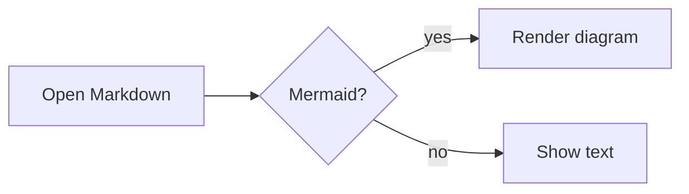

# Nixe on iOS

Bundled smoke-test document for the iPhone build. If everything below renders, the viewer works on the device.

## Text

**Bold**, *italic*, `inline code` and a [link](https://example.com).

- [x] Markdown
- [ ] Your own files (not yet on iOS)

## Mermaid



## KaTeX

Inline: $E = mc^2$ and $\sqrt{a^2+b^2}$.

$$
\int_{-\infty}^{\infty} e^{-x^2}\,dx = \sqrt{\pi}
$$

## Code

```rust
fn main() {
    println!("Hello from iPhone");
}
```
