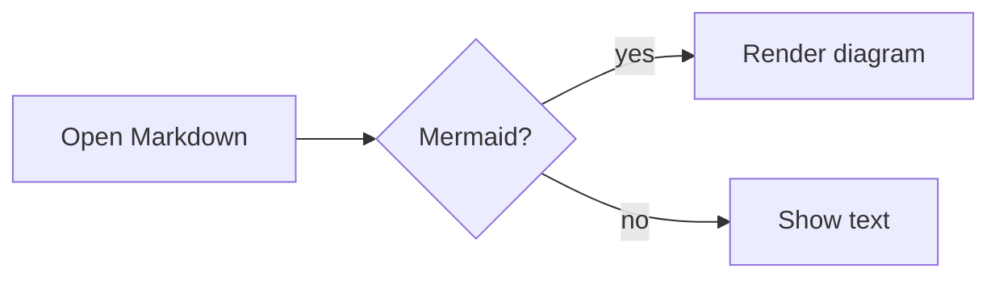

# Mermaid Examples

## Standard Code Block



## Azure DevOps Format

::: mermaid
 sequenceDiagram
     participant U as User
     participant N as Nixe
     U->>N: Open file
     N-->>U: Rendered Markdown
:::

## Gantt


## Class Diagram (ADO, without spaces)

:::mermaid
classDiagram
    class DocumentService {
      +open(path)
      +save()
    }
    DocumentService --> MarkdownService
:::

## Broken Diagram

```mermaid
graph TD
    A --> 
    this is not valid
```

Back to the [overview](README.md).
