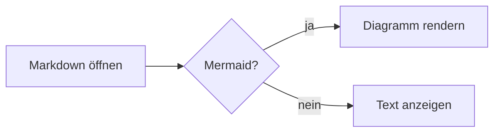
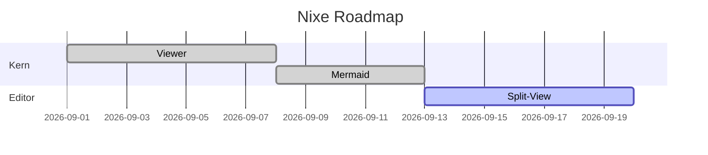

# Mermaid-Beispiele

## Standard-Codeblock



## Azure-DevOps-Format

::: mermaid
 sequenceDiagram
     participant U as Nutzer
     participant N as Nixe
     U->>N: Datei öffnen
     N-->>U: Gerendertes Markdown
:::

## Gantt



## Klassendiagramm (ADO, ohne Leerzeichen)

:::mermaid
classDiagram
    class DocumentService {
      +open(path)
      +save()
    }
    DocumentService --> MarkdownService
:::

## Fehlerhaftes Diagramm

```mermaid
graph TD
    A --> 
    this is not valid
```

Zurück zur [Übersicht](README.md).
